# KG Pay – Modélisation by Core Business Version-0.2

Version de travail 0.2 · 20 novembre 2026 · issue de la documentation fonctionnelle v0.1

**Légende.** ⚠️ = manquement restant à traiter · 🔧 = correction appliquée dans ce document · 🟡 = règle proposée, à valider. Aucune valeur chiffrée n'est inventée : seuils, durées et plafonds restent ouverts.

## 0. Corrections appliquées et règles proposées

### 0.1 Corrections apportées au référentiel

| # | Constat dans la v0.1 | Correction appliquée ici |
| --- | --- | --- |
| C1 | Deux noms pour le même objet : PAYMENT\_OPERATION (§5.5) et FINANCIAL\_OPERATION (§6, §7) | **FINANCIAL\_OPERATION** retenu partout. PAYMENT\_OPERATION devient un alias |
| C2 | Sommaire désaligné (le contenu a un §6 Modèle conceptuel, un §8 Bounded contexts, un §11 Glossaire) | Sommaire corrigé en §0.4 |
| C3 | Un cœur « Audit » est cité en interaction (§5.1, 5.9, 5.10) sans être défini | Cœur 13 **Audit et traçabilité** ajouté |
| C4 | Litiges et contestations cités (§5.10) sans cœur ni parcours | Cœur 14 **Litiges et contestations** ajouté |
| C5 | Security et Support cités sans cœur | Security rattaché au cœur 1 (accès) et au cœur 4 (secrets). Support rattaché au cœur 10 |
| C6 | PAYER cité mais jamais modélisé | PAYER défini comme objet léger rattaché à l'opération (cœur 5) |
| C7 | Versions de configuration et de tarif citées sans lien avec la tentative | La tentative mémorise la CONFIGURATION\_VERSION et la PRICING\_VERSION utilisées |
| C8 | « Compte bancaire vérifié » exigé sans cycle de vie | États de vérification ajoutés (cœur 7) |
| C9 | Pas de vue d'ensemble des échanges entre cœurs | Carte globale et catalogue d'événements ajoutés (§1) |
| C10 | États exprimés différemment selon les sections | Vocabulaire d'états normalisé (§0.3) |

### 0.2 Règles métier proposées 🟡

| Règle | Énoncé | Cœurs |
| --- | --- | --- |
| RP-01 | Un callback est idempotent : rejoué, il n'a aucun nouvel effet. Reçu après un état terminal, il est journalisé et passe en revue s'il contredit l'état | 4, 5 |
| RP-02 | Une opération INCONNUE bloque toute nouvelle exécution équivalente tant que son statut n'est pas établi | 5 |
| RP-03 | Un nouvel essai après échec certain est une nouvelle tentative rattachée à la même opération, avec sa propre référence partenaire | 5 |
| RP-04 | Le cumul des remboursements d'une opération ne dépasse pas le montant collecté | 5, 14 |
| RP-05 | Une tentative mémorise la version de configuration et de tarif utilisées. Publier une nouvelle version n'affecte pas les opérations déjà créées | 4, 5, 8 |
| RP-06 | Suspendre ou désactiver une méthode bloque les nouvelles opérations. Les opérations en cours vont à leur terme et le rapprochement continue | 3, 5 |
| RP-07 | Un client suspendu ne peut plus créer de nouvelle opération ni de versement. Les opérations en cours sont suivies jusqu'à leur terme | 2, 5, 7 |
| RP-08 | La clôture d'un client est impossible tant qu'il reste un solde non nul, une réservation ou une opération non terminale | 2, 6 |
| RP-09 | Le statut global d'un client est dérivé : dossier VALIDE et au moins un lien partenaire ACTIVE. L'autorisation reste toujours évaluée par méthode | 2 |
| RP-10 | Auto-approbation interdite : l'approbateur est différent du demandeur et de l'instructeur, même si une personne cumule les rôles | 1, 7, 10 |
| RP-11 | Un compte bancaire n'est utilisable pour un versement qu'à l'état VERIFIE. Toute modification de coordonnées le repasse à A\_VERIFIER | 7, 9 |
| RP-12 | Toute demande de versement approuvée a une date d'expiration (durée à fixer). À l'expiration, la réservation est libérée | 7 |
| RP-13 | Une écriture validée n'est jamais modifiée ni supprimée : on la corrige par une contre-passation | 6 |
| RP-14 | Un événement n'est notifié qu'après sa persistance par le domaine propriétaire | 12 |
| RP-15 | Un dossier client rejeté n'est pas rouvert : une nouvelle soumission crée un nouveau dossier lié à l'ancien | 2 |
| RP-16 | Les frais d'une opération échouée ou annulée avant exécution ne sont pas dus | 8 |
| RP-17 | Aucune action sensible n'aboutit sans événement d'audit associé | 13 |

### 0.3 Vocabulaire d'états normalisé

Le statut d'un échange avec le partenaire et le statut comptable sont deux faits distincts (principe de la v0.1, §6.1).

| Famille | États normalisés |
| --- | --- |
| FINANCIAL\_OPERATION | CREEE, VALIDEE, REFUSEE, SOUMISE, EN\_ATTENTE, REUSSIE, ECHOUEE, REJETEE, INCONNUE, EN\_VERIFICATION, REVUE\_MANUELLE, ANNULEE, EXPIREE |
| PAYMENT\_ATTEMPT | ENVOYEE, REPONSE\_RECUE, SANS\_REPONSE, CLOTUREE |
| Statut comptable de l'opération | NON\_COMPTABILISE, COMPTABILISE, EXTOURNE |
| Dossier client | BROUILLON, SOUMIS, A\_VERIFIER, INCOMPLET, VALIDE, REJETE, SUSPENDU, CLOTURE |
| Lien client-partenaire | DEMANDEE, EN\_COURS, ACTIVE, REFUSEE, SUSPENDUE |
| Demande de versement | BROUILLON, SOUMISE, REFUSEE\_AUTO, RESERVEE, EN\_INSTRUCTION, A\_APPROUVER, APPROUVEE, TRANSMISE, EN\_ATTENTE, VERSEE, ECHOUEE, INCONNUE, REJETEE, ANNULEE, EXPIREE |
| Compte bancaire bénéficiaire | A\_VERIFIER, VERIFIE, REFUSE, SUSPENDU, RETIRE |
| Version de configuration | BROUILLON, TEST\_SANDBOX, EN\_VALIDATION, PUBLIEE, ARCHIVEE |

### 0.4 Sommaire corrigé

1. Vision et positionnement · 2. Principes structurants · 3. Acteurs et vocabulaire · 4. Carte des cœurs métier · 5. Étude des cœurs · 6. Modèle conceptuel transversal · 7. Parcours de bout en bout · 8. Cœurs métier, bounded contexts et services · 9. Progression par étapes · 10. Décisions à consolider · 11. Glossaire.

## 1. Vue d'ensemble

### 1.1 Carte des cœurs et flux d'événements

Trait plein : dépendance fonctionnelle directe. Trait pointillé : publication d'événements.

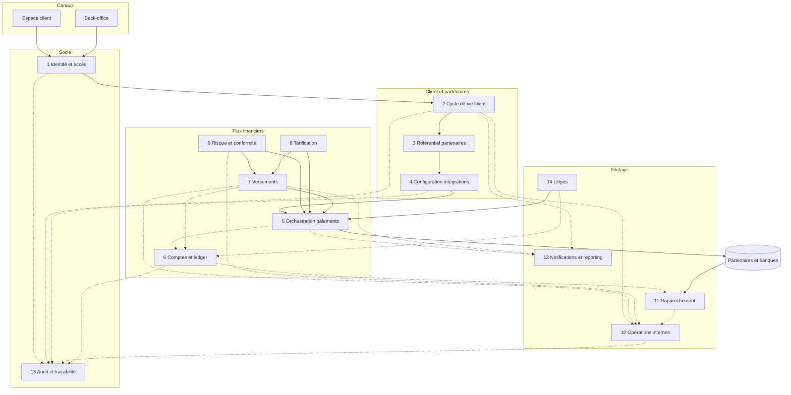

### 1.2 Catalogue d'événements inter-domaines

| Événement | Producteur | Consommateurs |
| --- | --- | --- |
| CustomerValidated | 2 Cycle de vie client | 1 Identité, 12 Notifications, 13 Audit |
| ActivationGranted (client, méthode) | 2 Cycle de vie client | 5 Orchestration, 12 Notifications, 13 Audit |
| CustomerSuspended | 2 Cycle de vie client | 5 Orchestration, 7 Versements, 9 Risque, 12 Notifications |
| BankAccountVerified | 2 Cycle de vie client | 7 Versements |
| MethodSuspended | 3 Référentiel | 2 Cycle de vie client, 5 Orchestration, 12 Notifications |
| ConfigurationPublished | 4 Configuration | 5 Orchestration, 13 Audit |
| OperationConfirmed | 5 Orchestration | 6 Ledger, 11 Rapprochement, 12 Notifications |
| OperationFailed | 5 Orchestration | 11 Rapprochement, 12 Notifications |
| OperationUnknown | 5 Orchestration | 10 Opérations internes, 11 Rapprochement |
| RefundCompleted | 5 Orchestration | 6 Ledger, 12 Notifications, 14 Litiges |
| FundsReserved / FundsReleased | 6 Ledger | 7 Versements |
| JournalPosted | 6 Ledger | 11 Rapprochement, 12 Reporting |
| PayoutSubmitted | 7 Versements | 6 Ledger, 10 Opérations internes |
| PayoutApproved | 10 Opérations internes | 7 Versements |
| PayoutConfirmed / PayoutFailed | 7 Versements | 6 Ledger, 12 Notifications |
| RiskAlertRaised | 9 Risque | 10 Opérations internes, 13 Audit |
| ReconciliationGapOpened | 11 Rapprochement | 10 Opérations internes, 12 Reporting |
| DisputeOpened / DisputeClosed | 14 Litiges | 5 Orchestration, 6 Ledger, 10 Opérations internes |

## Cœur 1 – Identité et contrôle des accès

**Mission.** Authentifier les identités et appliquer les droits de chaque profil. Porte aussi la sécurité d'accès (Security de la v0.1).

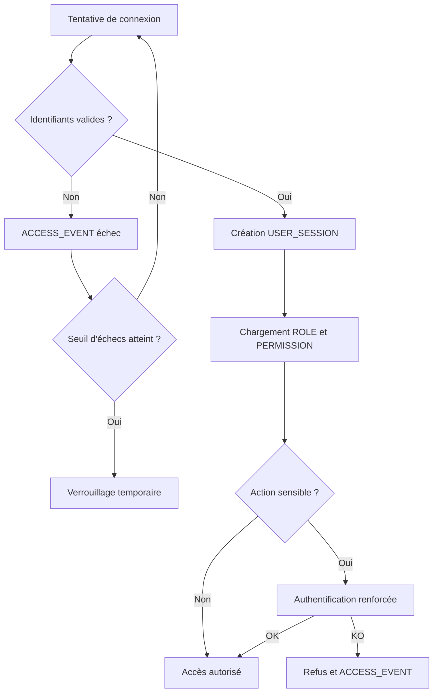

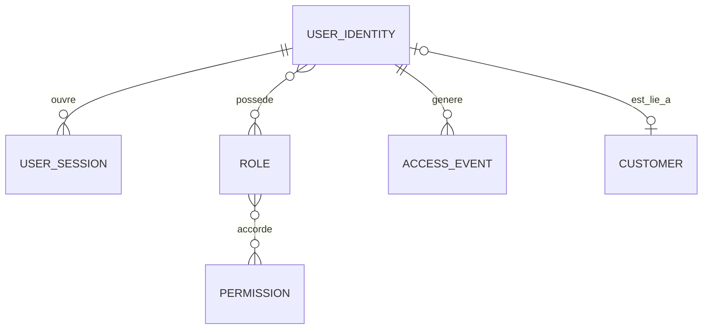

🔧 RP-10 (auto-approbation interdite) et RP-17 (audit des actions sensibles) s'appliquent ici.

⚠️ **Reste ouvert**

- Politique MFA, récupération de compte, durée de session.
- Statut de l'identité avant validation du dossier : connexion possible en BROUILLON ?
- Départ d'un collaborateur : désactivation immédiate et revue périodique des droits.
- Délégation temporaire et accès d'urgence.
- Liste précise des actions sensibles.

## Cœur 2 – Cycle de vie client

**Mission.** Gérer le particulier de son inscription à sa clôture, et son activation auprès des partenaires.

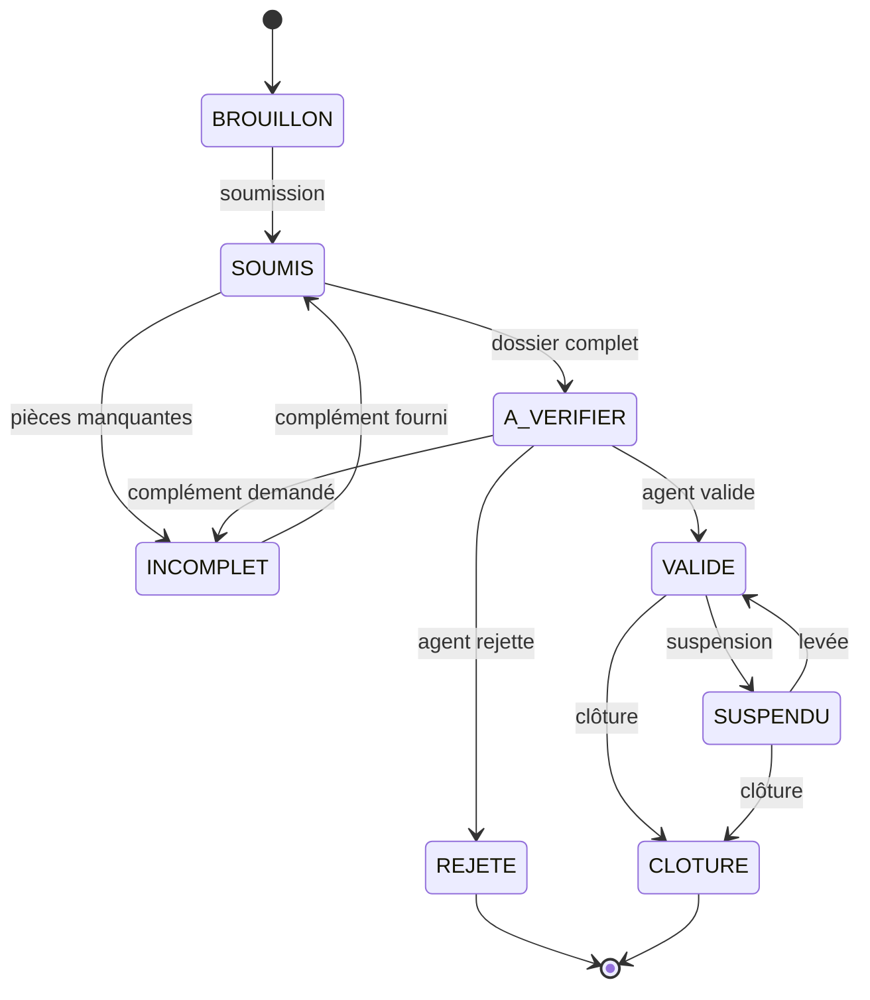

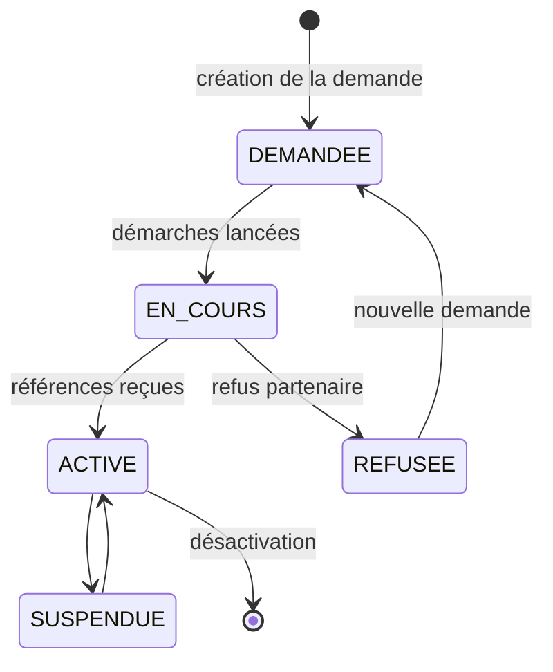

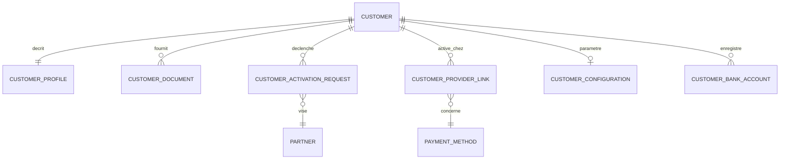

🔧 RP-07, RP-08, RP-09 et RP-15 comblent les points sur suspension, clôture, statut global et réouverture.

⚠️ **Reste ouvert**

- Critères de détection des doublons d'identité.
- Expiration des pièces et fréquence du réexamen périodique.
- Consentement, conservation et effacement des données face aux obligations de conservation.

## Cœur 3 – Référentiel des partenaires et méthodes

**Mission.** Dire quels prestataires et quels moyens de paiement existent, avec quelles capacités.

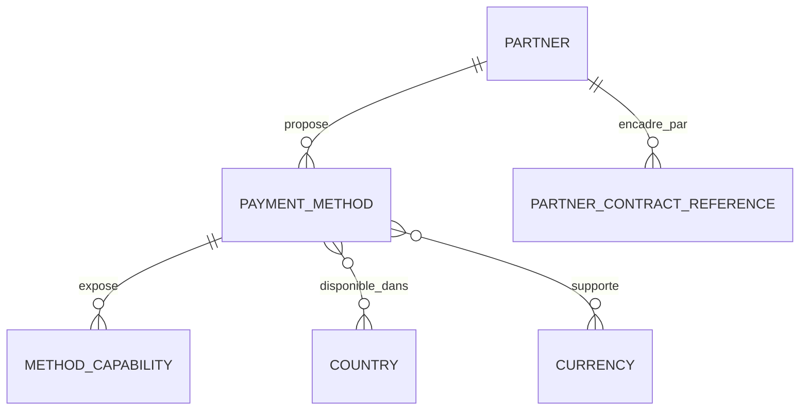

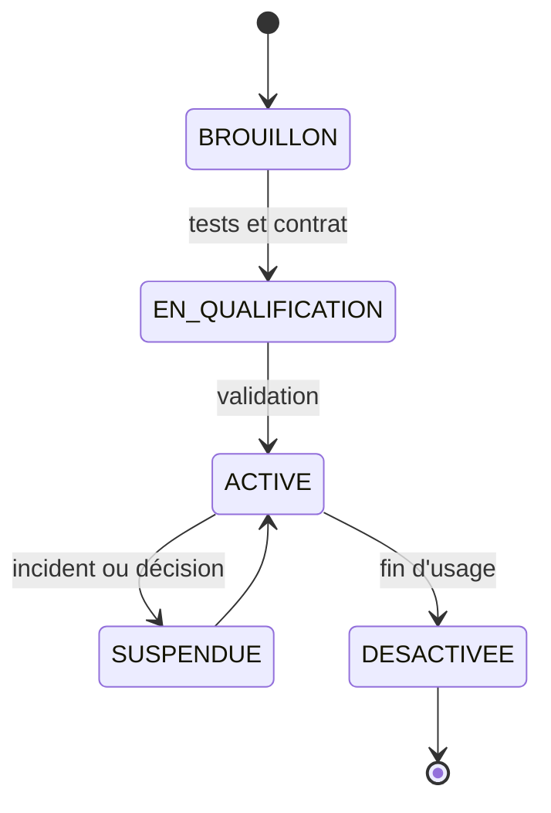

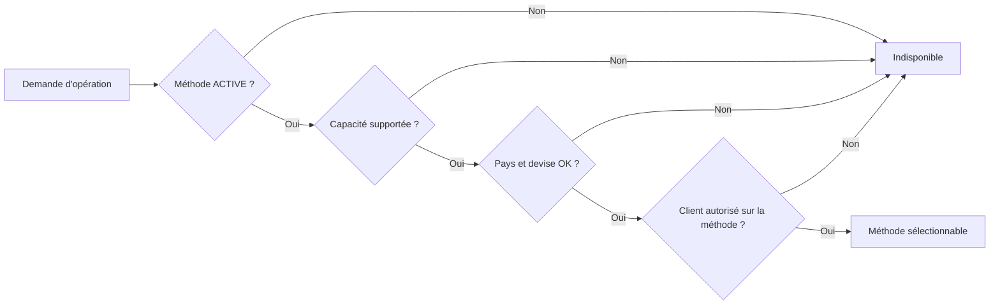

🔧 RP-06 fixe le sort des opérations en cours lors d'une suspension de méthode.

⚠️ **Reste ouvert**

- Plafonds par capacité : ici ou dans le cœur 9 ?
- Un remboursement partiel est-il une capacité distincte du remboursement total ?
- Historique des conditions contractuelles par période.

## Cœur 4 – Configuration des intégrations partenaires

**Mission.** Traduire de façon contrôlée les capacités métier en appels vers chaque partenaire. Porte la protection des secrets (Security de la v0.1).

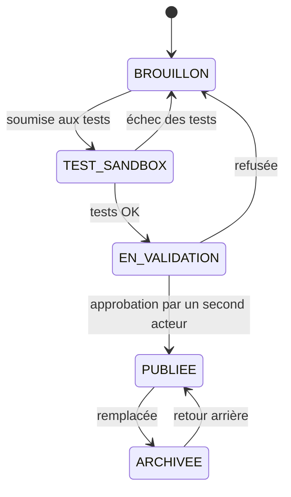

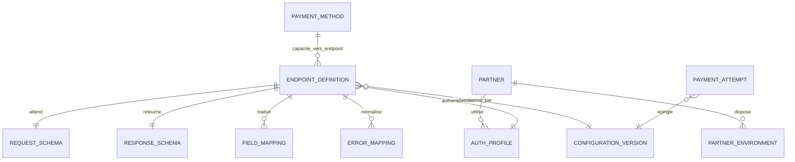

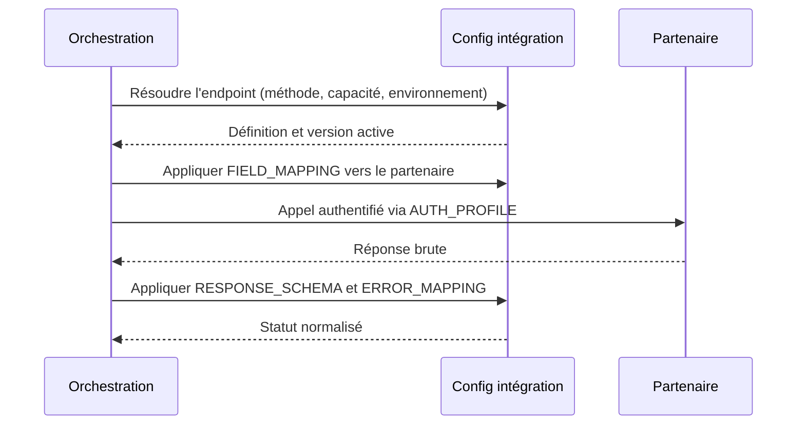

🔧 RP-01 (callbacks idempotents) et RP-05 (version épinglée sur la tentative) s'appliquent ici.

⚠️ **Reste ouvert**

- Rotation des secrets et des certificats, expiration des accès partenaires.
- Mécanisme d'authenticité des callbacks (signature, liste d'adresses autorisées).
- Limites d'appels du partenaire et délais d'attente par capacité.

## Cœur 5 – Orchestration des paiements

**Mission.** Piloter les opérations financières (collecte, remboursement, annulation, consultation d'état) et leur exécution chez un partenaire. Objet central : FINANCIAL\_OPERATION (alias PAYMENT\_OPERATION).

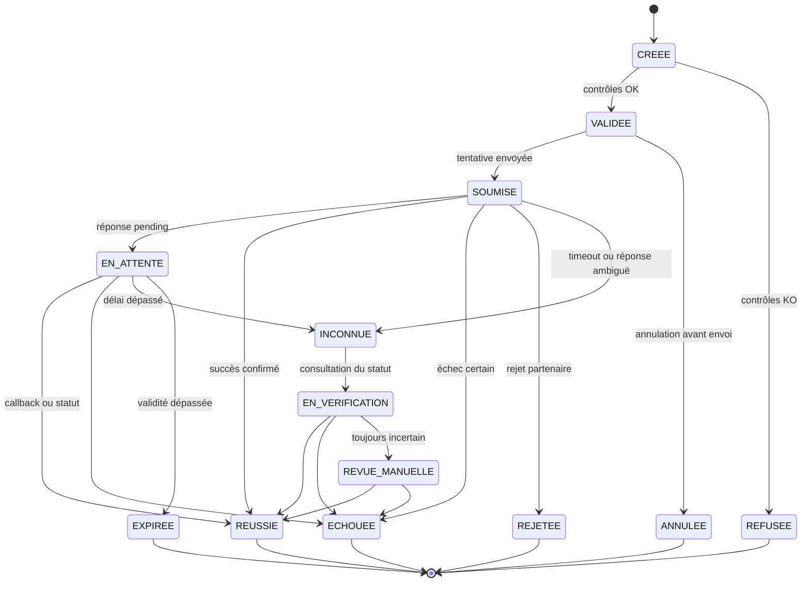

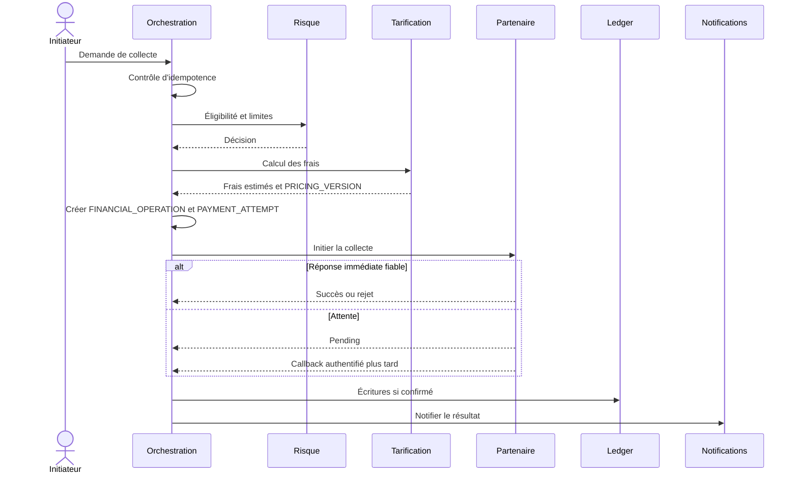

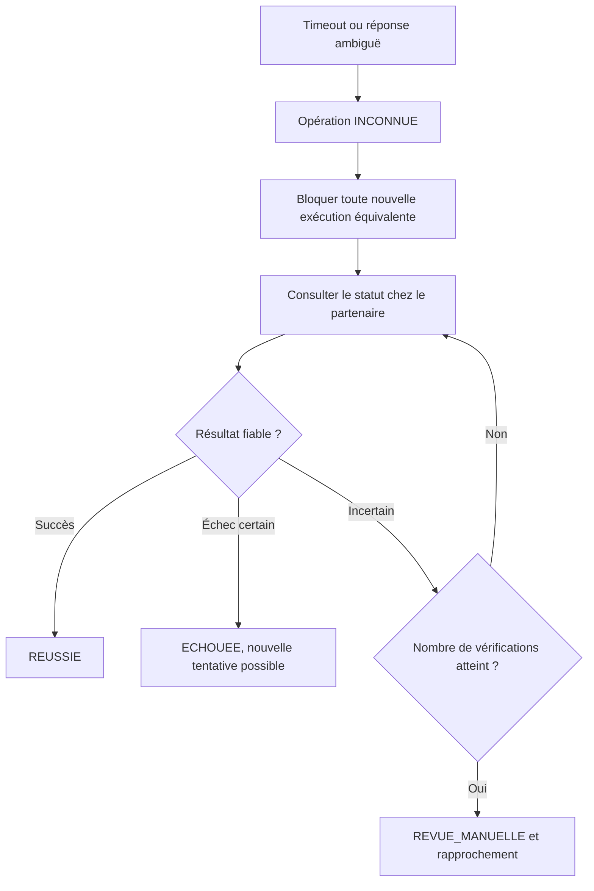

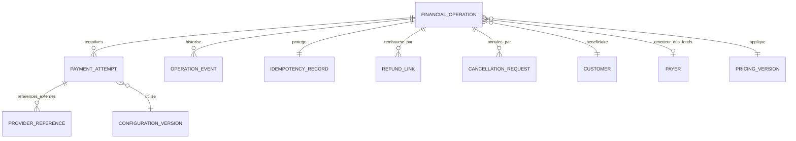

🔧 **PAYER** : objet léger rattaché à l'opération (nom, moyen de contact ou numéro de paiement). Il n'a ni compte plateforme ni droits d'accès, et n'est pas confondu avec le CUSTOMER. 🔧 RP-01 à RP-05 s'appliquent ici.

⚠️ **Reste ouvert**

- Qui initie la collecte (client, lien envoyé au payeur, opérateur, système tiers) : décision du §10 de la v0.1, qui change le parcours d'entrée.
- Durée de validité d'une collecte en attente et cadence des vérifications.
- Course entre réponse synchrone et callback : l'ordre d'arrivée ne doit pas changer le résultat (RP-01 pose le principe, le mécanisme reste à écrire).
- Données conservées sur le PAYER et leur durée.

## Cœur 6 – Comptes clients et comptabilité interne

**Mission.** Tenir une représentation fiable des montants reçus, dus, réservés, payés et prélevés. Le ledger est l'autorité comptable ; le solde affiché en est dérivé.

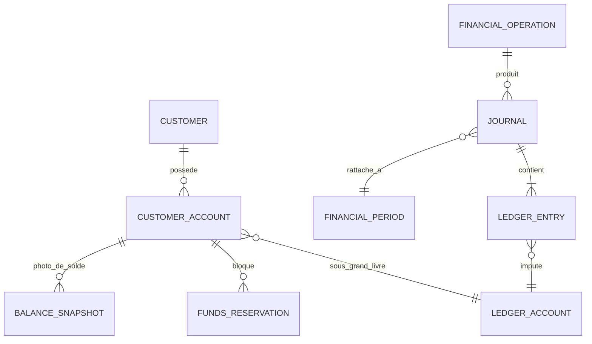

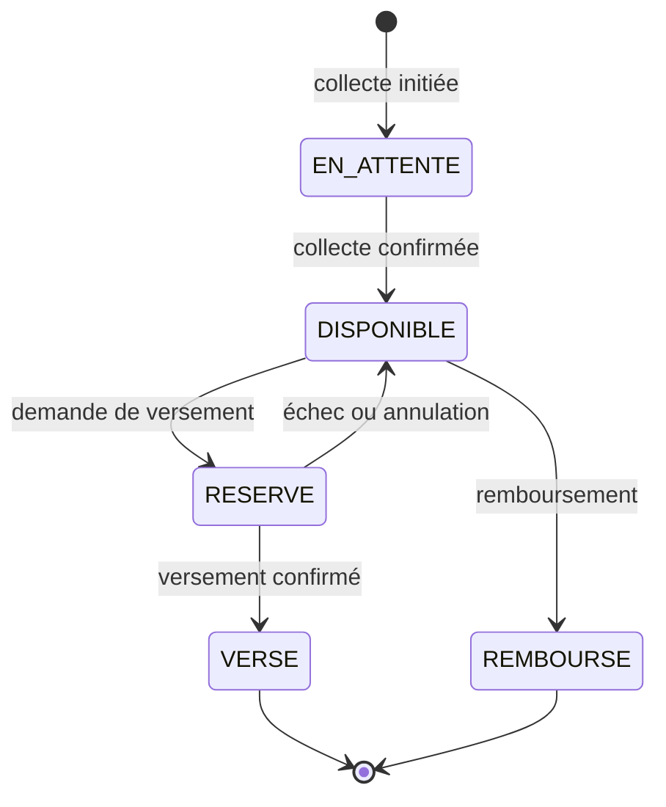

Imputations **illustratives** : le plan comptable réel reste à définir.

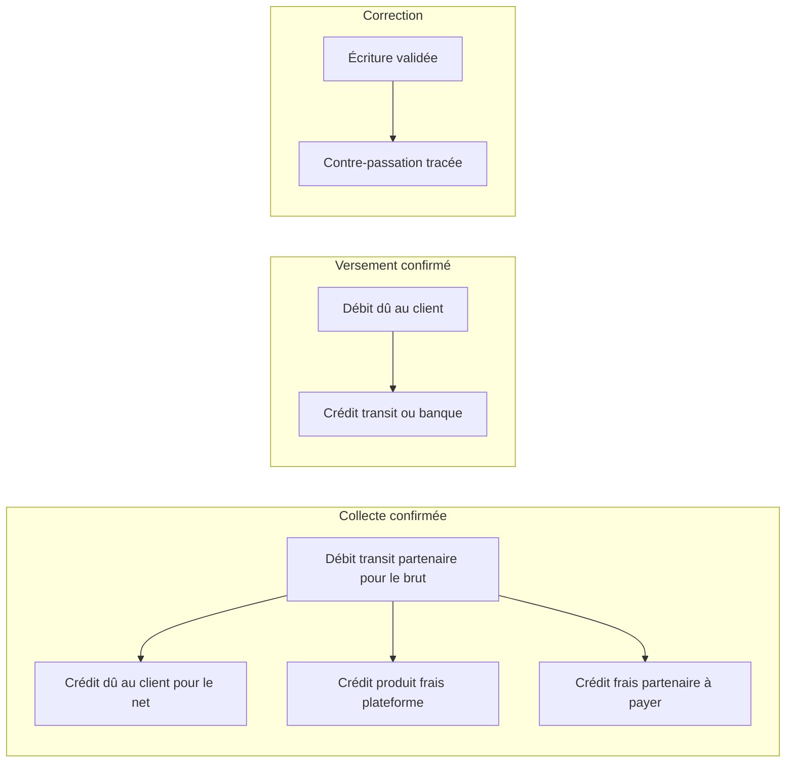

🔧 RP-13 (écriture jamais modifiée, contre-passation) et RP-08 (clôture client) s'appliquent ici.

⚠️ **Reste ouvert**

- Plan comptable, comptes de transit et de suspens.
- Délai éventuel entre confirmation et disponibilité des fonds.
- Solde négatif possible (remboursement ou contestation après versement) : qui supporte le risque ?
- Multi-devises, arrondis et conversions. Clôture de période et modifications après clôture. Taxes éventuelles sur les frais.
- Ces diagrammes supposent le modèle « suivi comptable ». Ils sont à revoir selon la décision sur la détention des fonds.

## Cœur 7 – Versements et décaissements

**Mission.** Permettre au client de demander le versement d'un montant vers un compte bancaire et encadrer le traitement jusqu'à confirmation fiable.

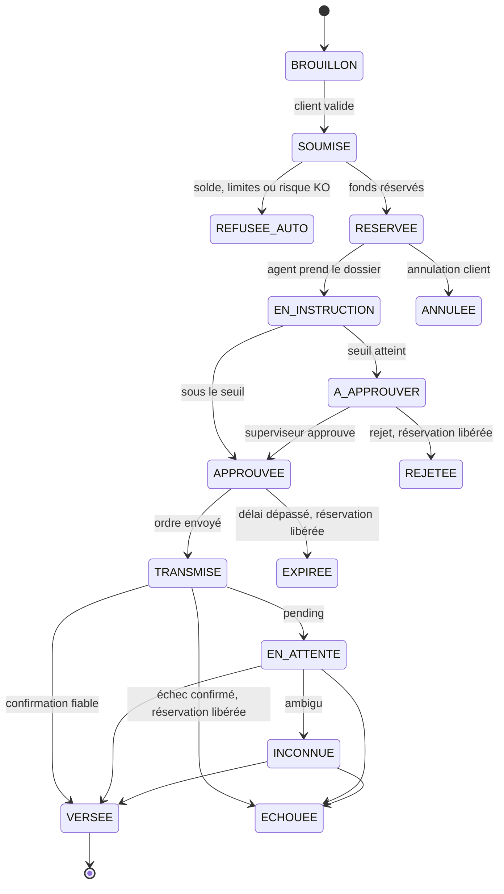

```mermaid
sequenceDiagram
    actor Cl as Client
    participant PAY as Versements
    participant LED as Ledger
    participant OPS as Opérations internes
    participant P as Partenaire
    Cl->>PAY: Demande avec compte et montant
    PAY->>LED: Solde disponible et réservation
    LED-->>PAY: Réservation confirmée
    PAY->>OPS: Créer le dossier
    OPS->>OPS: Instruction par l'agent
    OPS->>OPS: Approbation selon le seuil
    OPS-->>PAY: Décision
    PAY->>P: Ordre de versement
    P-->>PAY: Statut immédiat ou différé
    alt Confirmé
        PAY->>LED: Comptabiliser le versement
    else Échec confirmé
        PAY->>LED: Libérer la réservation
    end
```

🔧 **Cycle de vie du compte bancaire bénéficiaire** (RP-11) :

```mermaid
stateDiagram-v2
    [*] --> A_VERIFIER : ajout par le client
    A_VERIFIER --> VERIFIE : vérification par un agent
    A_VERIFIER --> REFUSE : vérification échouée
    VERIFIE --> A_VERIFIER : coordonnées modifiées
    VERIFIE --> SUSPENDU : alerte risque
    SUSPENDU --> VERIFIE : levée
    VERIFIE --> RETIRE : retrait par le client
    REFUSE --> [*]
    RETIRE --> [*]
```

```mermaid
erDiagram
    PAYOUT_REQUEST }o--|| CUSTOMER_BANK_ACCOUNT : vers
    CUSTOMER_BANK_ACCOUNT }o--|| BANK : dans
    CUSTOMER_BANK_ACCOUNT ||--|| BENEFICIARY : au_nom_de
    PAYOUT_REQUEST ||--o{ PAYOUT_APPROVAL : approuvee_par
    PAYOUT_REQUEST ||--o{ PAYOUT_ATTEMPT : executee_par
    PAYOUT_REQUEST ||--o{ PAYOUT_EVENT : historise
    PAYOUT_ATTEMPT }o--|| CONFIGURATION_VERSION : utilise
```

🔧 RP-10 (auto-approbation interdite), RP-11 (compte VERIFIE) et RP-12 (expiration) s'appliquent ici.

⚠️ **Reste ouvert**

- Procédure concrète de vérification du compte bancaire (preuve demandée, qui la contrôle).
- Seuils d'approbation et règles de délégation chiffrés. Délai de carence après changement de coordonnées.
- Frais déduits du montant demandé ou ajoutés ?
- Versement manuel hors partenaire : preuve de paiement et rapprochement. Retour bancaire tardif après un succès apparent. Versement partiel ou groupé.

## Cœur 8 – Tarification, frais et commissions

**Mission.** Définir les règles de calcul des frais et rendre le coût de chaque mouvement explicable. Calcule, ne comptabilise pas.

```mermaid
flowchart TD
    A[Opération initiée] --> B[Sélection de la PRICING_VERSION datée]
    B --> C{Tarif négocié pour ce client ?}
    C -->|Oui| D[CUSTOMER_FEE]
    C -->|Non| E[FEE_POLICY standard]
    D --> F[Appliquer FEE_RULE fixe, proportionnel, minimum, maximum]
    E --> F
    F --> G[Arrondi]
    G --> H[FEE_CALCULATION estimée liée à l'opération]
    H --> I[Retour partenaire ou rapprochement]
    I --> J{Frais réels égaux aux estimés ?}
    J -->|Oui| K[Confirmer]
    J -->|Non| L[Écart de frais, ajustement via le Ledger]
```

```mermaid
erDiagram
    FEE_POLICY ||--o{ FEE_RULE : contient
    FEE_POLICY }o--|| PRICING_VERSION : versionnee
    PARTNER ||--o{ PARTNER_FEE : facture
    CUSTOMER ||--o{ CUSTOMER_FEE : tarif_negocie
    FINANCIAL_OPERATION ||--o{ FEE_CALCULATION : frais_calcules
    FEE_CALCULATION }o--|| PRICING_VERSION : utilise
```

🔧 RP-05 (version de tarif figée à la création) et RP-16 (pas de frais sur échec ou annulation avant exécution) s'appliquent ici.

⚠️ **Reste ouvert**

- Qui supporte quels frais (client, payeur, plateforme).
- Frais d'une opération remboursée : rendus, conservés ou partagés ?
- Barèmes distincts collecte et versement. Taxes et arrondis par devise.
- Moment où le coût est affiché puis figé pour le client.

## Cœur 9 – Risque, conformité et éligibilité

**Mission.** Déterminer si un client ou une opération peut être accepté, limité, différé ou refusé.

```mermaid
flowchart TD
    A[Demande d'activation, de collecte ou de versement] --> B{Client ACTIVE sur la méthode ?}
    B -->|Non| R[REFUSER]
    B -->|Oui| C{Restriction en vigueur ?}
    C -->|Oui| R
    C -->|Non| D{Limites respectées ?}
    D -->|Non| R
    D -->|Oui| E{Signal d'alerte ?}
    E -->|Non| OK[AUTORISER]
    E -->|Oui| F[RISK_ALERT et COMPLIANCE_REVIEW]
    F --> G{Décision de la revue}
    G -->|Accepter| OK
    G -->|Rejeter| R
    G -->|Limiter ou différer| L[DIFFERER ou LIMITER]
```

```mermaid
erDiagram
    CUSTOMER ||--o{ KYC_CHECK : subit
    CUSTOMER ||--o{ RESTRICTION : peut_avoir
    ELIGIBILITY_RULE ||--o{ TRANSACTION_LIMIT : definit
    FINANCIAL_OPERATION ||--o{ RISK_ALERT : peut_declencher
    RISK_ALERT ||--o| COMPLIANCE_REVIEW : instruite_par
```

⚠️ **Reste ouvert**

- Niveaux de KYC éventuels, associés à des plafonds différents.
- Contrôles de listes et de sanctions : à qualifier avec la conformité.
- Obligations réglementaires locales (zone CEMAC envisagée) : à valider juridiquement, rien n'est présumé ici.
- Gel d'un client ou d'un montant sur décision d'une autorité. Conservation des preuves de décision.

## Cœur 10 – Opérations internes et gestion des dossiers

**Mission.** Organiser le travail humain autour des autres cœurs : affectation, validation, escalade. Porte aussi le support (Support de la v0.1).

```mermaid
stateDiagram-v2
    [*] --> NOUVEAU
    NOUVEAU --> AFFECTE : assignation
    AFFECTE --> EN_COURS : prise en charge
    EN_COURS --> EN_ATTENTE_EXTERNE : information attendue
    EN_ATTENTE_EXTERNE --> EN_COURS
    EN_COURS --> A_APPROUVER : validation requise
    A_APPROUVER --> RESOLU : approuvé
    A_APPROUVER --> EN_COURS : rejeté ou complément
    EN_COURS --> ESCALADE : échéance ou complexité
    ESCALADE --> EN_COURS : réaffecté
    EN_COURS --> RESOLU
    RESOLU --> CLOS
    CLOS --> [*]
```

```mermaid
flowchart LR
    A[Instruction par l'agent] --> B{Seuil de montant ou de risque atteint ?}
    B -->|Non| C[Décision de l'agent]
    B -->|Oui| D[Approbation par un superviseur différent du demandeur et de l'instructeur]
    C --> E[DECISION_RECORD]
    D --> E
```

```mermaid
erDiagram
    WORK_ITEM }o--o| CASE : regroupe_dans
    WORK_ITEM ||--o{ CASE_ASSIGNMENT : affecte
    WORK_ITEM ||--o{ APPROVAL : soumis_a
    WORK_ITEM ||--o{ REVIEW_COMMENT : annote
    WORK_ITEM ||--o{ DECISION_RECORD : decisions
    WORK_ITEM }o--|| SLA_TARGET : echeance
```

🔧 RP-10 appliquée : l'auto-approbation est interdite même en cas de cumul de rôles.

⚠️ **Reste ouvert**

- Catalogue des types de dossiers et priorités (activation, versement, anomalie, écart, litige, support).
- Valeurs de SLA, règles d'escalade, gestion des absences.

## Cœur 11 – Rapprochement et règlement financier

**Mission.** Vérifier que les opérations internes correspondent aux relevés des partenaires et des banques. Constate et suit les écarts, ne réexécute jamais une opération.

```mermaid
flowchart TD
    A[Import du PROVIDER_STATEMENT] --> B[Normalisation des lignes]
    B --> C[Appariement avec les opérations internes]
    C --> D{MATCH_RESULT}
    D -->|Identique| E[Rapproché]
    D -->|Absent chez nous| F[Écart opération manquante en interne]
    D -->|Absent chez le partenaire| G[Écart opération manquante chez le partenaire]
    D -->|Montant différent| H[Écart de montant]
    D -->|Statut divergent| I[Écart de statut]
    D -->|Doublon| J[Écart doublon]
    D -->|Frais non conformes| K[Écart de frais]
    F --> L[RECONCILIATION_CASE]
    G --> L
    H --> L
    I --> L
    J --> L
    K --> L
    L --> M[Correction autorisée par opération ou écriture]
    M --> N[Cas clos]
```

```mermaid
stateDiagram-v2
    [*] --> OUVERT
    OUVERT --> EN_ANALYSE
    EN_ANALYSE --> CORRECTION_PROPOSEE
    CORRECTION_PROPOSEE --> CORRIGE : correction autorisée
    EN_ANALYSE --> ACCEPTE : écart toléré et justifié
    CORRIGE --> CLOS
    ACCEPTE --> CLOS
    CLOS --> [*]
```

```mermaid
erDiagram
    RECONCILIATION_BATCH ||--o{ PROVIDER_STATEMENT : importe
    PROVIDER_STATEMENT ||--o{ MATCH_RESULT : produit
    MATCH_RESULT }o--o| FINANCIAL_OPERATION : apparie
    MATCH_RESULT ||--o| RECONCILIATION_CASE : ouvre_si_ecart
    SETTLEMENT ||--o{ SETTLEMENT_REFERENCE : references
    PROVIDER_STATEMENT }o--o| SETTLEMENT : reglement_associe
```

⚠️ **Reste ouvert**

- Formats réels des relevés (fichier ou API), fréquence, heure de coupure et fuseau.
- Clé d'appariement (référence interne, référence partenaire, montant et date) et tolérances.
- Règle de soldification du compte de transit lors d'un règlement.
- Rapprochement côté banque, en plus du côté partenaire.
- Qui autorise quelle correction selon le type d'écart.

## Cœur 12 – Notifications, webhooks et reporting

**Mission.** Informer les acteurs d'événements déjà établis par les autres cœurs et fournir une visibilité opérationnelle. Ne décide d'aucun état métier.

```mermaid
flowchart LR
    E[Événement établi par un domaine] --> T{Règle de notification ?}
    T -->|Non| X[Ignoré]
    T -->|Oui| U[Choix du destinataire et des préférences]
    U --> V[NOTIFICATION_TEMPLATE]
    V --> W[Envoi par canal]
    W --> Y{Livré ?}
    Y -->|Oui| Z[DELIVERY_ATTEMPT succès]
    Y -->|Non| R{Nouvel essai possible ?}
    R -->|Oui| W
    R -->|Non| F[Échec tracé et alerte]
```

```mermaid
erDiagram
    NOTIFICATION ||--|| NOTIFICATION_TEMPLATE : modele
    NOTIFICATION ||--o{ DELIVERY_ATTEMPT : tentatives_d_envoi
    WEBHOOK_SUBSCRIPTION ||--o{ DELIVERY_ATTEMPT : livraisons
    REPORT_DEFINITION ||--o{ KPI_SNAPSHOT : produit
```

🔧 RP-14 : un événement n'est notifié qu'après sa persistance par le domaine propriétaire.

⚠️ **Reste ouvert**

- Catalogue des notifications par destinataire (le §1.2 liste les événements sources), langues et canaux retenus.
- Alertes obligatoires que le client ne peut pas désactiver.
- Définition des KPI (taux de succès par tentative ou par opération ?).

## Cœur 13 – Audit et traçabilité (ajouté)

**Mission.** Conserver une trace infalsifiable de qui a fait quoi, quand, sur quel objet et pourquoi. La v0.1 le cite en interaction (cœurs 1, 9, 10) sans le définir.

```mermaid
flowchart LR
    A[Action sensible ou changement d'état] --> B[Domaine propriétaire exécute l'action]
    B --> C[Émission d'un AUDIT_EVENT]
    C --> D[Stockage en ajout seul, sans modification ni suppression]
    D --> E[Consultation par rôle autorisé]
    D --> F[Preuves pour revue, litige et conformité]
```

```mermaid
erDiagram
    AUDIT_EVENT }o--|| USER_IDENTITY : acteur
    AUDIT_EVENT }o--o| AUDIT_OBJECT_REF : porte_sur
    AUDIT_EVENT ||--o| AUDIT_JUSTIFICATION : motive_par
```

Contenu minimal d'un AUDIT\_EVENT : acteur ou système initiateur, action, référence de l'objet, valeur avant et après lorsque pertinent, horodatage, origine (canal), justification si requise. Cela reprend le principe de traçabilité du §2 de la v0.1.

⚠️ **À décider**

- Durée de conservation et règles d'accès aux journaux d'audit.
- Périmètre exact des actions auditées au-delà des actions sensibles (RP-17).

## Cœur 14 – Litiges et contestations (ajouté)

**Mission.** Traiter les contestations d'une opération (client, payeur, partenaire) et en tirer une décision tracée, éventuellement un remboursement ou une écriture de correction.

```mermaid
stateDiagram-v2
    [*] --> OUVERT : contestation reçue
    OUVERT --> QUALIFIE : opération identifiée et recevable
    OUVERT --> IRRECEVABLE : hors périmètre
    QUALIFIE --> EN_INSTRUCTION
    EN_INSTRUCTION --> REMBOURSEMENT_DECIDE : fondé
    EN_INSTRUCTION --> REFUSE : non fondé
    EN_INSTRUCTION --> ESCALADE_PARTENAIRE : traitement chez le partenaire
    ESCALADE_PARTENAIRE --> REMBOURSEMENT_DECIDE
    ESCALADE_PARTENAIRE --> REFUSE
    REMBOURSEMENT_DECIDE --> EXECUTE : remboursement ou contre-passation réalisé
    EXECUTE --> CLOS
    REFUSE --> CLOS
    IRRECEVABLE --> CLOS
    CLOS --> [*]
```

```mermaid
erDiagram
    DISPUTE }o--|| FINANCIAL_OPERATION : conteste
    DISPUTE ||--o{ DISPUTE_EVENT : historise
    DISPUTE ||--o| WORK_ITEM : instruit_par
    DISPUTE ||--o{ REFUND_LINK : debouche_sur
```

RP-04 s'applique : le cumul des remboursements ne dépasse pas le montant collecté.

⚠️ **À décider**

- Délais de recevabilité et canaux d'ouverture d'un litige.
- Qui supporte la perte si le client a déjà été versé (lien avec le solde négatif du cœur 6).

## Modèle conceptuel unifié

Vue d'ensemble des relations du §6 de la v0.1, complétée par les objets ajoutés.

```mermaid
erDiagram
    PARTNER ||--o{ PAYMENT_METHOD : propose
    PAYMENT_METHOD ||--o{ METHOD_CAPABILITY : expose
    PAYMENT_METHOD ||--o{ ENDPOINT_DEFINITION : implemente
    CUSTOMER ||--o{ CUSTOMER_PROVIDER_LINK : active_chez
    CUSTOMER_PROVIDER_LINK }o--|| PAYMENT_METHOD : concerne
    CUSTOMER ||--o{ CUSTOMER_ACCOUNT : possede
    CUSTOMER ||--o{ CUSTOMER_BANK_ACCOUNT : enregistre
    CUSTOMER ||--o{ FINANCIAL_OPERATION : beneficie
    PAYER ||--o{ FINANCIAL_OPERATION : emet
    FINANCIAL_OPERATION ||--o{ PAYMENT_ATTEMPT : tentatives
    FINANCIAL_OPERATION ||--o{ OPERATION_EVENT : historise
    FINANCIAL_OPERATION ||--o{ JOURNAL : comptabilise
    FINANCIAL_OPERATION ||--o{ FEE_CALCULATION : frais
    FINANCIAL_OPERATION ||--o{ REFUND_LINK : rembourse_par
    JOURNAL ||--|{ LEDGER_ENTRY : contient
    CUSTOMER_ACCOUNT ||--o{ FUNDS_RESERVATION : bloque
    PAYOUT_REQUEST }o--|| CUSTOMER_BANK_ACCOUNT : vers
    PAYOUT_REQUEST ||--o{ PAYOUT_ATTEMPT : executee_par
    PAYOUT_REQUEST ||--o| FUNDS_RESERVATION : reserve
    DISPUTE }o--|| FINANCIAL_OPERATION : conteste
    MATCH_RESULT }o--o| FINANCIAL_OPERATION : apparie
    AUDIT_EVENT }o--o| FINANCIAL_OPERATION : trace
```

## Synthèse

**Ce qui est réglé dans ce document :** les incohérences de nommage, le sommaire, les deux cœurs manquants (13 et 14), les objets non modélisés (PAYER, compte bancaire vérifié), l'épinglage des versions sur les tentatives, le vocabulaire d'états et 17 règles proposées à valider (§0.2).

**Ce qui ne peut pas se régler sans une décision métier ou juridique :**

| Décision (v0.1 §10) | Cœurs impactés |
| --- | --- |
| Détention et conservation des fonds, nature du compte client | 6, 7, 11, 14 |
| Qui initie la collecte, rôle du PAYER | 5, 8, 9 |
| Qui supporte les frais, frais sur remboursement | 5, 6, 8, 14 |
| Seuils d'approbation, SLA, expiration des demandes (valeurs) | 7, 10 |
| Obligations réglementaires, niveaux de KYC | 2, 9 |
| Capacités de versement et de remboursement par partenaire | 3, 4, 7 |

**Suite proposée :** valider ou amender les règles RP-01 à RP-17, puis trancher les décisions ci-dessus dans l'ordre d'impact, puis détailler les cas d'usage et exceptions cœur par cœur (premier : cycle de vie client, comme recommandé dans la v0.1).
