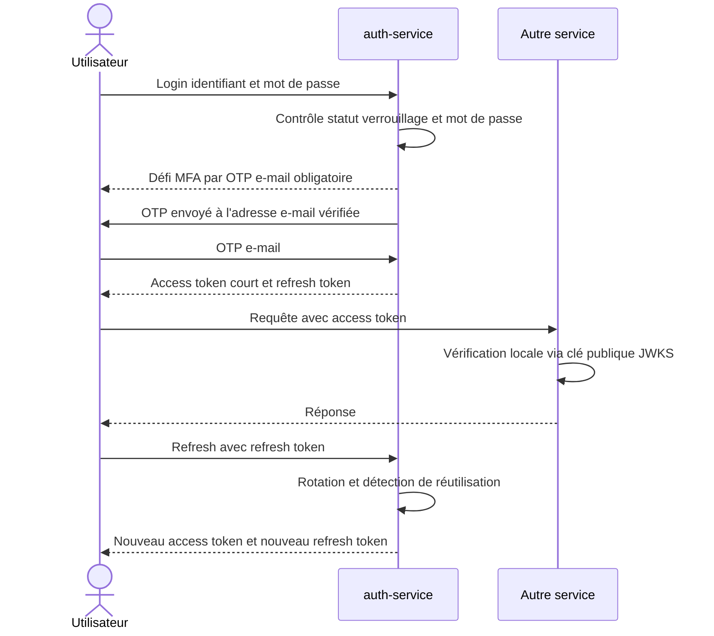
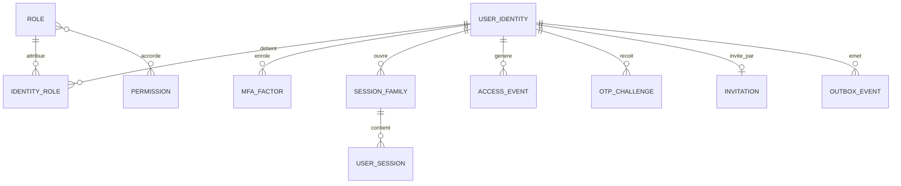
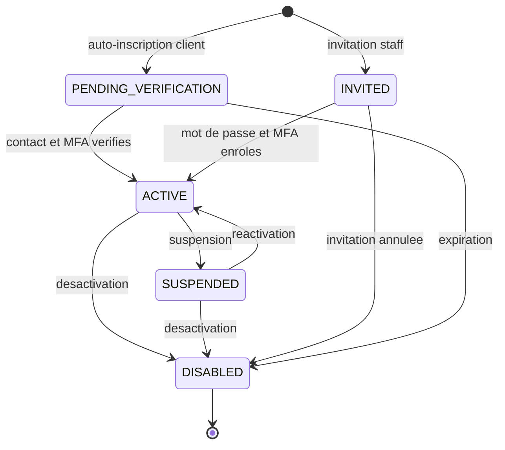

# CDC-01 — Identité et contrôle des accès

**Projet :** KG Pay (Kab Gateway Payment)
**Cœur métier :** 1 — Identité et contrôle des accès
**Service porteur :** `auth-service`
**Version du CDC :** 0.1 — Validé comme base V1, points ouverts conservés
**Date :** 20 novembre 2026
**Cœur précédent :** aucun (premier cœur : ce document sert de référence initiale)
**Sources :** référentiel v0.3 (§5.1, annexe A cœur 1, B.1 cœur 1, RP-01 à RP-17), ADR-001
**Canaux couverts :** interfaces web client/personnel et backend du cœur 1 ; le dossier client et sa vérification métier restent au cœur 2.

**Légende des marqueurs**

- **[RÉFÉRENTIEL]** : déjà établi dans le référentiel v0.3.
- **[DÉCISION]** : choix exprimé par le porteur du projet.
- **[PROPOSITION]** : choix proposé dans ce CDC, à valider. Toutes les valeurs chiffrées sont des valeurs par défaut configurables, pas des engagements.

---

## 1. Résumé exécutif

Le cœur 1 répond à la question : **qui utilise la plateforme et que peut-il faire ?** Il authentifie deux familles de sujets (les **clients particuliers** et le **personnel interne**), impose le MFA à toutes les identités, gère leurs sessions, applique un contrôle d'accès par rôles et permissions, impose une authentification renforcée pour les actions sensibles et journalise les accès.

Il ne décide **ni de l'éligibilité financière, ni du statut du dossier client, ni du solde** : ces sujets appartiennent aux cœurs 2, 6 et 9. Une identité authentifiée n'est pas une autorisation d'opération financière.

Il est le socle de tous les autres cœurs : il émet les jetons que chaque service vérifie localement, publie le catalogue de rôles et de permissions, et fournit l'identité stable (`identityId`) sur laquelle reposent la séparation des tâches (RP-10) et l'audit (RP-17).

**Ce que livre la V1 :** inscription et connexion des clients, comptes internes créés par invitation, mot de passe robuste, OTP par e-mail obligatoire pour toutes les identités à chaque nouvelle connexion, sessions révocables, verrouillage progressif, rôles intégrés et rôles personnalisés limités à un catalogue de permissions, authentification renforcée (step-up), journal des accès et désactivation immédiate d'un collaborateur, ainsi que les interfaces web d'authentification nécessaires à ces parcours.

Le présent CDC couvre donc le backend et les interfaces du cœur 1. Les interfaces client et personnel peuvent être des applications distinctes ; leur découpage de déploiement reste à valider conformément à ADR-002. La création du compte d'identité et la vérification du contact sont dans ce CDC ; l'examen manuel du dossier client et les justificatifs KYC sont du ressort du cœur 2.

Le porteur valide ce CDC comme base de travail V1 le 21 novembre 2026. Le facteur de connexion est un OTP par e-mail pour `CUSTOMER` et `STAFF`, envoyé après validation du mot de passe à chaque nouvelle connexion [DÉCISION du porteur, 21 novembre 2026]. Cette solution est distincte de TOTP et dépend de la sécurité de la boîte e-mail ; les paramètres, la récupération après perte d'accès à la boîte et le fournisseur de production restent à préciser. Aucun parcours n'émet une session complète sans OTP vérifié.

## 2. Périmètre

### 2.1 Dans le périmètre V1

Authentification, sessions, MFA obligatoire pour les clients et le personnel, récupération de compte, rôles et permissions, comptes internes, step-up, journal des accès (ACCESS_EVENT), publication des clés de vérification (JWKS), événements d'identité.

Interfaces web responsive correspondantes : inscription client, vérification du contact, connexion, récupération du compte ; acceptation d'invitation et enrôlement MFA du personnel ; écrans de session et de déconnexion. Les règles backend demeurent l'autorité pour la validation et l'autorisation.

**Portée de l'incrément backend en cours :** établir le socle `auth-service` et implémenter l'OTP e-mail pour `CUSTOMER` et `STAFF`, ainsi que les rôles et permissions validés. SMTP générique est retenu ; Maildev est le serveur local de développement et les paramètres secrets sont injectés à l'exécution. Les interfaces restent requises par ce CDC, mais ne font pas partie de cette tranche backend.

### 2.2 Hors périmètre V1 (documenté, non développé)

- SSO / fédération d'identité d'entreprise.
- Délégation temporaire de droits et accès d'urgence (« break-glass ») [RÉFÉRENTIEL : réserve ouverte].
- Rôles/permissions définis hors du catalogue fermé ou attribués par un autre rôle que `GLOBAL_SUPER_ADMIN`.
- Plusieurs utilisateurs par client (un seul utilisateur principal par client) [RÉFÉRENTIEL §3].
- Authentification des API tierces (clés d'API B2B) [RÉFÉRENTIEL : piste future].
- Authentification des partenaires externes (leurs callbacks relèvent du cœur 4).
- Constitution complète du dossier client, dépôt et examen interne des pièces KYC, décision d'activation client et activation partenaire (cœur 2).
- PWA, mode hors ligne, applications mobiles natives et API publique d'intégration.

### 2.3 Frontières : ce que ce cœur ne fait pas [RÉFÉRENTIEL]

- Il ne porte pas le dossier KYC, le statut du dossier client ni les liens client-partenaire (cœur 2).
- Il ne connaît pas les soldes ni les opérations.
- Il ne vérifie pas la **propriété** d'une ressource (« ce dossier est-il bien celui de ce client ? ») : chaque service le fait sur ses propres données. Le cœur 1 fournit l'identité et les permissions, pas les décisions de propriété.
- Il ne stocke pas les traces d'audit métier (cœur 13) : il émet des événements d'audit et tient son propre journal d'accès.

## 3. Acteurs, sujets et rôles

### 3.1 Types de sujets

| Type (`subjectType`) | Qui                                 | Création du compte                           |
| -------------------- | ----------------------------------- | -------------------------------------------- |
| `CUSTOMER`           | Particulier client de la plateforme | Auto-inscription                             |
| `STAFF`              | Collaborateur interne               | Invitation par un administrateur d'identités |

### 3.2 Rôles V1 [DÉCISION sur les rôles intégrés et la gestion des rôles personnalisés]

| Rôle                  | Sujet    | Description                                                                                                                                                                          |
| --------------------- | -------- | ------------------------------------------------------------------------------------------------------------------------------------------------------------------------------------ |
| `CUSTOMER`            | CUSTOMER | Gère son propre accès. Les permissions métier seront ajoutées par les cœurs concernés.                                                                                               |
| `GLOBAL_SUPER_ADMIN`  | STAFF    | Détient toutes les permissions du catalogue et seul gère les identités, la sécurité, l'attribution des rôles et les rôles personnalisés. RP-10 s'applique sans exception.            |
| `OPERATIONS_ADMIN`    | STAFF    | Traite les dossiers et opérations selon les permissions définies dans les CDC concernés ; ne gère pas les identités, les rôles ou les configurations partenaires.                    |
| `CONFIGURATION_ADMIN` | STAFF    | Gère le catalogue partenaires/méthodes et les intégrations selon les permissions définies dans les CDC concernés ; ne gère pas les identités, les rôles ou l'approbation financière. |

Le porteur confirme quatre rôles intégrés : `CUSTOMER` et les trois rôles STAFF ci-dessus. `GLOBAL_SUPER_ADMIN` peut créer des rôles personnalisés, en sélectionnant uniquement des permissions présentes dans le catalogue versionné. Il est seul à créer/inviter, désactiver et administrer les identités STAFF, attribuer les rôles et gérer la sécurité. Les permissions métier exactes de `OPERATIONS_ADMIN` et `CONFIGURATION_ADMIN` seront définies par les CDC des cœurs concernés ; elles ne sont pas inventées par `auth-service`.

### 3.3 Règles de compatibilité des rôles [DÉCISION]

- Les rôles STAFF intégrés et personnalisés peuvent être cumulés ; seules les permissions explicitement attribuées s'appliquent.
- Le `GLOBAL_SUPER_ADMIN` dispose de toutes les permissions du catalogue. RP-10 demeure une contrainte métier indépendante des rôles : l'approbateur doit être différent du demandeur et de l'instructeur, y compris si l'un d'eux est super-admin.
- `OPERATIONS_ADMIN` et `CONFIGURATION_ADMIN` ne reçoivent pas les permissions d'administration des identités par héritage.
- Un `CUSTOMER` ne peut détenir aucun rôle `STAFF` et inversement.
- Personne ne peut modifier ses propres rôles.

## 4. Parcours principaux

### 4.1 Inscription d'un client

1. Le particulier fournit une adresse e-mail, un numéro de téléphone de contact et un mot de passe.
2. L'identité est créée à l'état `PENDING_VERIFICATION` ; seul l'e-mail est vérifié. Le téléphone sert uniquement à contacter le client si nécessaire et n'est ni un identifiant de connexion ni un facteur d'authentification.
3. Après vérification de l'e-mail, l'identité passe à `ACTIVE` et l'événement `IdentityRegistered` est publié (le cœur 2 crée alors le dossier client en `BROUILLON`).
4. À chaque nouvelle connexion par e-mail, un OTP est envoyé après validation du mot de passe ; aucune session complète n'est émise avant validation de cet OTP.
5. **La connexion est autorisée dès `ACTIVE`, même si le dossier est encore `BROUILLON`** : seules les permissions de complétion du dossier sont disponibles, l'éligibilité financière étant jugée par les cœurs 2 et 9. _(Tranche la réserve « connexion possible en BROUILLON ? ».)_

### 4.2 Création d'un compte interne

1. Un `GLOBAL_SUPER_ADMIN` crée l'identité `STAFF` avec ses rôles (action sensible : step-up requis).
2. Un lien d'invitation à usage unique (validité par défaut 48 h) est émis.
3. Le collaborateur définit son mot de passe et vérifie son adresse e-mail. Pour chaque nouvelle connexion, un OTP est envoyé après validation du mot de passe ; aucune session complète n'est émise avant vérification.

### 4.3 Connexion, refresh et rotation



Si un refresh token **déjà consommé** est présenté, toute la famille de sessions concernée est révoquée (suspicion de vol) et un événement d'alerte est journalisé.

### 4.4 Action sensible (step-up)

Pour une action sensible (liste en §8.6), le service concerné exige une preuve de step-up. L'utilisateur l'obtient auprès d'`auth-service` en repassant un second facteur ; la preuve est courte (5 min par défaut), liée à la session et à la catégorie d'action.

### 4.5 Départ d'un collaborateur

Un `GLOBAL_SUPER_ADMIN` désactive l'identité : toutes ses sessions sont révoquées immédiatement, l'événement `IdentityDisabled` est publié, et un contrôle périodique signale les comptes inactifs.

### 4.6 Parcours dans les interfaces web

- Le parcours client présente l'inscription, la vérification du contact et la connexion conformément aux règles backend. Après activation de l'identité, le client peut être dirigé vers la complétion de son dossier, qui relève du cœur 2 et n'est pas implémentée par `auth-service`.
- Le parcours personnel commence par une invitation, la définition du mot de passe et la vérification de l'adresse e-mail. Chaque nouvelle connexion exige ensuite un OTP e-mail après le mot de passe.
- Les interfaces distinguent l'état de l'identité de celui du dossier client. Elles ne présentent pas une identité active comme une preuve de dossier client validé.
- Les erreurs d'identifiants restent uniformes afin de ne pas révéler l'existence d'un compte. Les textes d'interface et messages d'erreur sont disponibles en français et en anglais.
- Les interactions sont utilisables sur mobile et desktop. Le mode PWA est une extension ultérieure, pas une condition du parcours d'authentification initial.

## 5. Exigences fonctionnelles

Priorités : **P0** = indispensable V1, **P1** = V1 si possible, **P2** = après V1.

| ID       | Exigence                                                                                                                                                       | Prio | Critère d'acceptation                                                                                                                                                                                                                                                  |
| -------- | -------------------------------------------------------------------------------------------------------------------------------------------------------------- | ---- | ---------------------------------------------------------------------------------------------------------------------------------------------------------------------------------------------------------------------------------------------------------------------- |
| IAM-F-01 | Auto-inscription d'un client par e-mail, avec téléphone de contact, mot de passe et OTP e-mail obligatoire à chaque nouvelle connexion.                        | P0   | L'e-mail est vérifié avant l'activation ; le téléphone n'est qu'une donnée de contact non vérifiée. Aucune session complète n'est émise sans OTP e-mail valide ; `IdentityRegistered` n'est publié qu'après vérification de l'e-mail.                                  |
| IAM-F-02 | Unicité de l'adresse e-mail utilisée comme identifiant de connexion.                                                                                           | P0   | Une seconde inscription avec le même e-mail est refusée, sans révéler si le compte existe (message uniforme). Le numéro de téléphone n'est pas un identifiant et n'a pas à être unique.                                                                                |
| IAM-F-03 | Création de comptes internes par invitation, avec vérification de l'adresse e-mail et MFA obligatoire par OTP e-mail.                                          | P0   | Seul `GLOBAL_SUPER_ADMIN` peut créer/inviter un compte STAFF. Le compte n'atteint `ACTIVE` qu'après définition du mot de passe et vérification de l'adresse ; chaque nouvelle connexion exige un OTP e-mail valide. Le lien d'invitation est à usage unique et expire. |
| IAM-F-04 | Connexion par e-mail et mot de passe, suivie d'un OTP e-mail.                                                                                                  | P0   | Après mot de passe valide, un défi OTP est créé et envoyé à l'adresse vérifiée ; aucun jeton de session complet n'est émis avant validation de l'OTP. Le téléphone n'est pas accepté comme identifiant. Échec du mot de passe : message uniforme.                      |
| IAM-F-05 | Jeton d'accès court (JWT signé asymétriquement) et jeton de rafraîchissement opaque, rotatif, stocké haché.                                                    | P0   | Un refresh token ne peut servir qu'une fois ; sa réutilisation révoque la famille de sessions.                                                                                                                                                                         |
| IAM-F-06 | Publication des clés publiques de vérification (JWKS) avec identifiant de clé (`kid`) et rotation.                                                             | P0   | Un service tiers vérifie un jeton sans appeler `auth-service` ; une clé tournée reste valide pendant la période de chevauchement.                                                                                                                                      |
| IAM-F-07 | Politique de mot de passe : longueur minimale, refus des mots de passe courants, hachage argon2id.                                                             | P0   | Un mot de passe trop court ou de la liste de mots courants est refusé ; aucun mot de passe n'apparaît en clair en base ni dans les journaux.                                                                                                                           |
| IAM-F-08 | Verrouillage progressif après échecs répétés, par identité et par IP.                                                                                          | P0   | Après N échecs consécutifs, la connexion est refusée jusqu'à `lockedUntil`, même avec le bon mot de passe ; la durée augmente à chaque verrouillage successif.                                                                                                         |
| IAM-F-09 | Récupération de compte (mot de passe oublié) par OTP e-mail ou lien à usage unique ; changement de mot de passe.                                               | P0   | Le code/lien est à usage unique, borné dans le temps et limité en essais ; après réinitialisation ou changement, toutes les autres sessions sont révoquées.                                                                                                            |
| IAM-F-10 | MFA obligatoire pour toutes les identités : OTP e-mail après le mot de passe à chaque nouvelle connexion.                                                      | P0   | Aucun sujet ne peut ouvrir une session complète avant validation de l'OTP e-mail associé à la connexion. Les OTP expirés, déjà consommés ou ayant dépassé la limite d'essais sont refusés ; aucun OTP n'est journalisé.                                                |
| IAM-F-11 | Gestion des sessions : lister ses sessions, en révoquer une ou toutes ; limite de sessions simultanées.                                                        | P1   | Une session révoquée refuse le refresh ; l'access token en circulation expire au plus tard à son échéance courte.                                                                                                                                                      |
| IAM-F-12 | Rôles intégrés, rôles personnalisés et permissions issues d'un catalogue fermé et versionné (`@kgpay/contracts`).                                              | P0   | Seul `GLOBAL_SUPER_ADMIN` peut créer un rôle personnalisé en choisissant dans le catalogue ; toute permission inconnue est refusée. Le jeton expose une version de permissions permettant aux services consommateurs de rejeter les droits non reconnus.               |
| IAM-F-13 | Attribution et retrait des rôles à un compte interne, selon les règles de compatibilité (§3.3).                                                                | P0   | Seul `GLOBAL_SUPER_ADMIN` peut attribuer les rôles STAFF ; une attribution incompatible est refusée, l'auto-attribution est impossible et l'action est auditée.                                                                                                        |
| IAM-F-14 | Authentification renforcée (step-up) pour les actions sensibles : émission d'une preuve courte, liée à la session et à la catégorie d'action.                  | P0   | Une preuve expirée, d'une autre catégorie ou d'une autre session est refusée par `@RequireStepUp`.                                                                                                                                                                     |
| IAM-F-15 | Cycle de vie de l'identité : suspension, réactivation, désactivation (terminale), déblocage manuel.                                                            | P0   | Suspension ou désactivation révoque immédiatement les sessions ; l'identité désactivée ne peut pas se reconnecter ni être réactivée.                                                                                                                                   |
| IAM-F-16 | Journal des accès (ACCESS_EVENT) : connexions réussies ou refusées, verrouillages, MFA, changements de mot de passe, détections de réutilisation, révocations. | P0   | Chaque événement contient identité (si connue), type, résultat, IP, user-agent, horodatage UTC, `correlationId` ; aucun secret n'y figure.                                                                                                                             |
| IAM-F-17 | Émission d'événements d'identité et d'audit via Transactional Outbox (RP-14, RP-17).                                                                           | P0   | Un événement n'est publié qu'après persistance du changement ; une panne du broker ne perd aucun événement.                                                                                                                                                            |
| IAM-F-18 | Endpoint d'introspection interne pour les actions critiques nécessitant l'état courant de la session.                                                          | P1   | Retourne actif/inactif et rôles courants ; accessible uniquement aux services autorisés.                                                                                                                                                                               |
| IAM-F-19 | Revue périodique des accès internes : rapport des comptes, rôles, dernière connexion ; désactivation automatique après inactivité prolongée.                   | P1   | Un compte `STAFF` inactif au-delà du seuil est désactivé et l'événement est émis.                                                                                                                                                                                      |
| IAM-F-20 | Création du premier super-administrateur par commande CLI ponctuelle, sans mot de passe par défaut.                                                            | P0   | Le premier `GLOBAL_SUPER_ADMIN` est créé hors API publique ; il définit un mot de passe et vérifie son OTP e-mail avant toute action privilégiée.                                                                                                                      |
| IAM-F-21 | Rattachement d'une identité à un CUSTOMER du cœur 2.                                                                                                           | P0   | Géré **côté cœur 2** (le client stocke l'`identityId`) ; `auth-service` ne connaît pas le CUSTOMER (voir §10, point 2).                                                                                                                                                |
| IAM-F-22 | Interfaces web client/personnel pour les parcours d'identité couverts par ce CDC.                                                                              | P0   | Les interfaces consomment les contrats du cœur 1 et couvrent les parcours §4.1 à §4.6 ; aucune interface ne contourne les contrôles backend.                                                                                                                           |
| IAM-F-23 | Présentation bilingue des parcours d'authentification (français/anglais) et adaptation mobile/desktop.                                                         | P0   | Les libellés, erreurs et instructions MFA sont disponibles dans les deux langues et restent utilisables sur petit et grand écran.                                                                                                                                      |
| IAM-F-24 | Affichage distinct de l'identité et du dossier client.                                                                                                         | P0   | Une identité `ACTIVE` n'est jamais présentée comme une preuve de validation du dossier ; le statut client est fourni par le cœur 2.                                                                                                                                    |
| IAM-F-25 | Pour une action d'interface explicitement annulable, attendre deux secondes avant d'envoyer la requête et permettre l'annulation durant ce délai.              | P1   | Annuler avant la fin du délai n'envoie aucune requête ; après délai, l'interface n'affiche la réussite qu'après réponse serveur et affiche explicitement toute erreur. Les actions de sécurité et financières ne sont concernées qu'après validation de leur CDC.      |

## 6. Règles métier

### 6.1 Règles du référentiel applicables [RÉFÉRENTIEL]

| Règle | Application dans ce cœur                                                                                                                                                                                             |
| ----- | -------------------------------------------------------------------------------------------------------------------------------------------------------------------------------------------------------------------- |
| RP-10 | Ce cœur garantit l'unicité et la stabilité de l'`identityId` et empêche l'auto-attribution de rôles ; le contrôle « approbateur ≠ demandeur ≠ instructeur » est appliqué là où l'approbation a lieu (cœurs 7 et 10). |
| RP-14 | Les événements d'identité sont publiés après persistance (outbox).                                                                                                                                                   |
| RP-17 | Toute action sensible produit un événement d'audit associé.                                                                                                                                                          |

### 6.2 Règles propres au cœur 1 [PROPOSITION]

| Règle    | Énoncé                                                                                                                                                                                                              |
| -------- | ------------------------------------------------------------------------------------------------------------------------------------------------------------------------------------------------------------------- |
| IAM-R-01 | Une adresse e-mail utilisée comme identifiant est unique parmi toutes les identités, tous types confondus. Le téléphone est uniquement une donnée de contact.                                                       |
| IAM-R-02 | Une réponse d'authentification ne permet jamais de déterminer si un identifiant existe.                                                                                                                             |
| IAM-R-03 | Un refresh token est à usage unique ; sa réutilisation révoque toute la famille de sessions.                                                                                                                        |
| IAM-R-04 | Suspendre ou désactiver une identité révoque immédiatement ses sessions. Une identité désactivée ne peut pas être réactivée.                                                                                        |
| IAM-R-05 | La suspension d'un **dossier client** (cœur 2, RP-07) ne désactive pas l'identité : le client reste connecté pour consulter ses opérations en cours. L'interdiction d'opérer est appliquée par les cœurs 2, 5 et 7. |
| IAM-R-06 | Un utilisateur ne peut pas modifier ses propres rôles ni lever son propre verrouillage ou sa propre suspension.                                                                                                     |
| IAM-R-07 | Aucune identité (`CUSTOMER` ou `STAFF`) ne peut devenir `ACTIVE` ni ouvrir une session complète sans second facteur enrôlé et vérifié.                                                                              |
| IAM-R-08 | Un changement de mot de passe, de contact ou de facteur MFA révoque les autres sessions et produit un événement d'audit.                                                                                            |
| IAM-R-09 | Les preuves de step-up sont à usage unique recommandé, de courte durée, et liées à la session et à une catégorie d'action.                                                                                          |
| IAM-R-10 | Les jetons ne contiennent aucune donnée personnelle au-delà d'identifiants techniques.                                                                                                                              |

## 7. Modèle conceptuel et états

### 7.1 Objets métier

`USER_IDENTITY`, `ROLE`, `PERMISSION` [RÉFÉRENTIEL]. Ajoutés par ce CDC : `IDENTITY_ROLE`, `MFA_FACTOR`, `OTP_CHALLENGE`, `INVITATION`, `SESSION_FAMILY`, `OUTBOX_EVENT`. `USER_SESSION` et `ACCESS_EVENT` [RÉFÉRENTIEL].



**Champs essentiels de `USER_IDENTITY`** : `id` (UUIDv7), `subjectType`, `email`, `phone`, `passwordHash`, `status`, `emailVerifiedAt`, `phoneVerifiedAt`, `failedAttempts`, `lockedUntil`, `lastLoginAt`, `createdAt`, `disabledAt`.

### 7.2 États administratifs de l'identité



Le verrouillage temporaire n'est **pas** un état : il est dérivé de `lockedUntil > maintenant` et n'est pas persistant au sens administratif.

## 8. Partie technique

### 8.1 Service et stack [DÉCISION sur le framework et la base ; autres choix à valider]

| Élément                   | Choix                                                                                                                                                                                        |
| ------------------------- | -------------------------------------------------------------------------------------------------------------------------------------------------------------------------------------------- |
| Service                   | `auth-service`, NestJS avec Express, TypeScript strict. [DÉCISION]                                                                                                                           |
| Base de données           | PostgreSQL dédiée à `auth-service`, Prisma, schéma propre au service. [DÉCISION]                                                                                                             |
| Hachage                   | argon2id pour les mots de passe ; SHA-256 pour les refresh tokens ; HMAC-SHA-256 avec sel aléatoire et clé runtime dédiée pour les OTP.                                                     |
| Signature des jetons      | Asymétrique (EdDSA ou RS256), clé privée uniquement dans `auth-service`, publication JWKS.                                                                                                   |
| Limitation de débit       | En mémoire par instance en V1 ; Redis introduit quand `auth-service` passe en multi-instance.                                                                                                |
| Événements                | Transactional Outbox ; en l'absence de broker, le relay local journalise les identifiants/noms d'événement sans payload et conserve les messages en outbox. Le broker reste à confirmer (ADR-001 D7). |
| Envoi d'OTP               | SMTP générique configurable, Maildev en développement ; aucun code n'est journalisé. Le fournisseur SMTP de production reste ouvert.                                                       |
| Interfaces web            | React/Vite/TypeScript comme base de travail proposée, à confirmer dans le dépôt cible ; deux surfaces de public distinct peuvent partager des composants de présentation réellement communs. |
| Contrats frontend/backend | `@kgpay/contracts` partagé au build pour les schémas Yup et types de requête/réponse ; validation frontend d'aide à la saisie seulement, validation backend obligatoire.                     |
| Langues                   | Français et anglais pour les interfaces d'authentification. La langue initiale et la mémorisation de la préférence restent à définir.                                                        |
| Déploiement/routage       | Cible proposée : domaine commun et chemins de service (ex. `/auth/*`) via routage d'infrastructure ; faisabilité mutualisée à confirmer selon ADR-002.                                       |

### 8.2 Contrat des jetons

**Access token (JWT)** — durée courte.

```json
{
  "iss": "<AUTH_ISSUER>",
  "aud": "<AUTH_AUDIENCE>",
  "sub": "<identityId>",
  "sid": "<sessionId>",
  "typ": "CUSTOMER | STAFF",
  "roles": ["OPERATIONS_ADMIN"],
  "pv": 1,
  "amr": ["pwd", "otp"],
  "iat": 0,
  "exp": 0,
  "jti": "<uuid>"
}
```

**Preuve de step-up (JWT)** : `typ = "stepup"`, `sub`, `sid`, `act` (catégorie d'action), `exp` (5 min), `jti` (permet l'usage unique côté service consommateur).

**Refresh token** : valeur opaque aléatoire, stockée hachée, liée à une `SESSION_FAMILY`.

**Permissions** : le catalogue rôle → permissions est un artefact versionné de `@kgpay/contracts`. Chaque cœur y déclare ses permissions au fur et à mesure de son développement ; `pv` permet de détecter un jeton émis avant un changement de catalogue.

Format des permissions : `domaine.ressource.action`. Exemples du cœur 1 : `iam.identity.read`, `iam.identity.create`, `iam.identity.suspend`, `iam.identity.disable`, `iam.role.assign`, `iam.session.revoke`, `iam.access-event.read`, `iam.access-review.read`.

### 8.3 Événements

| Événement                                   | Rôle                                      | Consommateurs prévus                                |
| ------------------------------------------- | ----------------------------------------- | --------------------------------------------------- |
| `IdentityRegistered`                        | Publié après activation d'un client       | 2 Cycle de vie client                               |
| `IdentityActivated`                         | Publié à l'activation d'un compte interne | 13 Audit                                            |
| `IdentitySuspended` / `IdentityReactivated` | Cycle de vie administratif                | 13 Audit, 12 Notifications                          |
| `IdentityDisabled`                          | Départ ou retrait définitif               | 13 Audit, 10 Opérations (réaffectation de dossiers) |
| `RoleAssigned` / `RoleRevoked`              | Changement de droits                      | 13 Audit                                            |
| `SessionRevoked`                            | Révocation (manuelle, sécurité)           | Services qui mettent des sessions en cache          |
| `OtpRequested`                              | Demande d'envoi d'un code                 | 12 Notifications                                    |
| `AccessAuditEvent`                          | Actions sensibles et échecs notables      | 13 Audit                                            |

Les schémas (nom, version, payload) vivent dans `@kgpay/contracts`. Les consommateurs sont idempotents.

### 8.4 API indicative (non contractuelle)

Les chemins ci-dessous donnent la forme attendue ; les contrats finaux seront figés avec le code et exposés en OpenAPI.

| Groupe                      | Chemins indicatifs                                                                                                                                                                                                                   |
| --------------------------- | ------------------------------------------------------------------------------------------------------------------------------------------------------------------------------------------------------------------------------------ |
| Inscription et vérification | `POST /auth/register`, `POST /auth/verify-contact`, `POST /auth/otp/resend`                                                                                                                                                          |
| Session                     | `POST /auth/login`, `POST /auth/mfa/verify`, `POST /auth/refresh`, `POST /auth/logout`, `POST /auth/logout-all`                                                                                                                      |
| Mot de passe et contacts    | `POST /auth/password/forgot`, `POST /auth/password/reset`, `POST /auth/password/change`, `POST /auth/email/change`, `POST /auth/email/change/verify`, `POST /auth/contact/phone`                                                   |
| MFA et step-up              | `POST /auth/mfa/verify`, `POST /auth/step-up`                                                                                                                                                                                         |
| Sessions personnelles       | `GET /auth/sessions`, `DELETE /auth/sessions/{id}`                                                                                                                                                                                   |
| Invitation                  | `POST /auth/invitations/accept`, `POST /admin/identities/{id}/invitation/resend`                                                                                                                                                    |
| Administration              | `POST /admin/identities`, `GET /admin/identities`, `POST /admin/identities/{id}/suspend`, `.../reactivate`, `.../disable`, `.../unlock`, `POST /admin/identities/{id}/roles`, `GET /admin/access-events`, `GET /admin/access-review` |
| Clés et interne             | `GET /.well-known/jwks.json`, `POST /internal/introspect`                                                                                                                                                                            |

### 8.5 Paramètres configurables et valeurs par défaut proposées

Toutes ces valeurs sont des **propositions à valider**, pas des engagements ; elles sont lues depuis la configuration, jamais codées en dur.

| Paramètre                                | Valeur par défaut                                              | Remarque                                                      |
| ---------------------------------------- | -------------------------------------------------------------- | ------------------------------------------------------------- |
| Durée de l'access token                  | 10 min                                                         | Fenêtre maximale de latence de révocation sans introspection. |
| Durée du refresh token — client          | 30 jours, glissante                                            |                                                               |
| Durée du refresh token — staff           | 8 h absolues, inactivité max 30 min                            |                                                               |
| Sessions simultanées max                 | 5 (client), 3 (staff)                                          |                                                               |
| Échecs avant verrouillage                | 5                                                              |                                                               |
| Durée du 1er verrouillage                | 15 min, doublée à chaque verrouillage consécutif, plafond 24 h |                                                               |
| Longueur minimale du mot de passe        | 10 caractères                                                  | Pas de règle de composition imposée.                          |
| OTP : durée / longueur / essais          | 5 min / 6 chiffres / 5 essais                                  |                                                               |
| OTP : renvoi                             | 60 s entre deux envois, 5 envois par heure                     |                                                               |
| Validité d'une invitation                | 48 h                                                           |                                                               |
| Validité d'une preuve de step-up         | 5 min                                                          |                                                               |
| Inactivité avant désactivation (staff)   | 90 jours                                                       |                                                               |
| Rotation des clés de signature           | 90 jours avec période de chevauchement                         |                                                               |
| Limite de tentatives de connexion par IP | 10 par minute                                                  |                                                               |

### 8.6 Actions sensibles (liste initiale) [PROPOSITION]

Soumises à step-up :

- Création de compte interne, attribution ou retrait de rôle.
- Suspension, désactivation, déblocage d'une identité.
- Modification de coordonnées bancaires d'un client (cœur 2 / 7).
- Approbation d'un versement (cœur 7 / 10).
- Publication d'une configuration partenaire (cœur 4).
- Export de données personnelles ou financières.

Chaque cœur ajoute ses actions sensibles à la liste au fil de son CDC, avec la catégorie d'action correspondante.

### 8.7 Exigences de sécurité

- Message d'erreur d'authentification uniforme ; temps de réponse non discriminant (pas d'énumération de comptes).
- Aucun secret, mot de passe, OTP, refresh token ni jeton complet dans les journaux, les événements ou les messages d'erreur.
- Les OTP de vérification du contact, de MFA de connexion et de récupération de mot de passe sont à usage et finalité distincts, à durée limitée, à usage unique et stockés sous forme hachée.
- La clé privée de signature n'est jamais exposée ni versionnée.
- Contrôle de l'origine (CORS restreint), en-têtes de sécurité, TLS obligatoire en production.
- Identifiant de corrélation propagé dans toutes les réponses et tous les journaux.
- Protection contre le rejeu des OTP et des preuves de step-up.
- Les tentatives d'accès croisé (accéder à la session ou aux données d'autrui) sont refusées et journalisées.

### 8.8 Observabilité

Journaux structurés (JSON) avec `correlationId`. Métriques minimales : connexions réussies/échouées, verrouillages, réutilisations de refresh token détectées, OTP envoyés/échoués, latence des endpoints d'authentification. Point de santé (`/health`) indépendant de l'authentification.

### 8.9 Stratégie de tests

| Niveau      | À couvrir                                                                                                                                                         |
| ----------- | ----------------------------------------------------------------------------------------------------------------------------------------------------------------- |
| Unitaire    | Politique de mot de passe, calcul du verrouillage, rotation de refresh, génération et validation des jetons, règles de compatibilité des rôles.                   |
| Intégration | Persistance Prisma, outbox (publication après commit, reprise après panne), invitation, OTP.                                                                      |
| E2E         | Parcours §4.1 à §4.5 complets.                                                                                                                                    |
| Sécurité    | Énumération de comptes, force brute, réutilisation de refresh, jeton falsifié, mauvais `kid`, step-up expiré ou détourné, auto-attribution de rôle, accès croisé. |
| Contrat     | Les services consommateurs valident les jetons réels émis par `auth-service` via JWKS.                                                                            |

### 8.10 Exigences frontend et contrats partagés [PROPOSITION]

- Les écrans d'authentification utilisent les schémas de transport et types publiés par `@kgpay/contracts` lorsque ceux-ci sont disponibles.
- Les schémas partagés ne contiennent pas les décisions d'autorisation ni les règles métier ; les mêmes entrées sont toujours contrôlées côté serveur.
- Les applications web gardent leurs composants, navigation et état propres ; les composants partagés ne portent aucune règle d'accès.
- L'application utilise une instance Axios dédiée à `auth-service`, créée par une fabrique multi-service commune avec un `baseURL` configurable. La même fabrique peut créer une instance par autre service sans coupler leurs déploiements.
- Les intercepteurs n'ajoutent l'authentification qu'aux appels qui l'exigent selon une règle explicite ; ils ne journalisent jamais le corps, les identifiants, les OTP/MFA ou les jetons.
- Une erreur d'API est affichée sans donnée secrète et avec le même niveau de discrétion que le contrat backend. Les jetons, OTP et mots de passe ne sont jamais journalisés par le navigateur.
- Le navigateur n'affiche une action permise qu'à titre d'ergonomie ; le service valide la permission et la propriété à chaque requête.
- Le navigateur conserve l'access token en mémoire et transmet le refresh token dans un cookie `Secure`, `HttpOnly`. Les origines autorisées, `SameSite`, CSRF/XSS et le détail du renouvellement doivent être précisés avant l'intégration et la mise en production.
- L'interface affiche les montants ou devises uniquement lorsque le contrat backend les fournit ; elle ne réalise pas de calcul financier.
- Pour une action explicitement marquée annulable, l'interface montre un compte à rebours de deux secondes avec une commande d'annulation et n'envoie la requête qu'à l'expiration du délai. En cas d'annulation, aucun appel n'est effectué ; après envoi, le résultat UI dépend de la réponse serveur.
- Le backend n'utilise `deletedAt` que pour les ressources dont le CDC métier autorise une suppression logique. Les entrées comptables, les événements d'audit et les preuves financières ne sont jamais supprimés physiquement.

## 9. Cas limites et exceptions

- **Réutilisation d'un refresh token** : famille révoquée, alerte journalisée.
- **Désactivation pendant une action en cours** : l'access token existant reste valide jusqu'à son expiration courte ; les actions sensibles exigent step-up ou introspection, ce qui bloque l'identité désactivée.
- **Changement d'e-mail** : vérification de la nouvelle adresse, révocation des autres sessions et événement d'audit. Le changement du téléphone de contact ne modifie pas les moyens d'authentification.
- **Perte d'accès à la boîte e-mail (CUSTOMER)** : récupération uniquement par le support ; aucun déblocage self-service vers le téléphone de contact.
- **Perte d'accès à la boîte e-mail (STAFF)** : réinitialisation par `GLOBAL_SUPER_ADMIN` avec step-up et audit.
- **Dernier `GLOBAL_SUPER_ADMIN`** : on ne peut pas désactiver ni retirer le rôle du dernier super-administrateur actif.
- **Doublon d'inscription simultané** : une contrainte d'unicité en base tranche, une seule inscription aboutit.
- **OTP de finalités différentes** : un code de vérification d'adresse ou de récupération de mot de passe ne peut pas satisfaire le défi MFA de connexion.
- **Indisponibilité du broker** : l'outbox conserve les événements, l'authentification reste fonctionnelle.
- **Indisponibilité d'`auth-service`** : les services qui vérifient localement via JWKS continuent à accepter les jetons valides ; les nouvelles connexions, refresh et step-up échouent.

## 10. Points ouverts et décisions associées

| #   | Point ouvert                                                                        | Recommandation                                                                                                                                                                                                         |
| --- | ----------------------------------------------------------------------------------- | ---------------------------------------------------------------------------------------------------------------------------------------------------------------------------------------------------------------------- |
| 1   | Délivrance des OTP avant l'existence du cœur 12.                                    | Port SMTP générique pour les e-mails, Maildev en développement ; configurer le fournisseur SMTP de production au déploiement.                                                                                          |
| 2   | Où stocker le lien identité ↔ CUSTOMER ?                                            | Côté cœur 2 (le client référence l'`identityId`) pour éviter une dépendance circulaire. Le référentiel montre la relation sans en fixer le propriétaire.                                                               |
| 3   | Identifiants de connexion et usage du téléphone.                                    | [DÉCISION] Seul l'e-mail est un identifiant vérifié ; le numéro est conservé comme moyen de contact non vérifié, sans login ni SMS d'authentification.                                                                 |
| 4   | Permissions statiques dans les jetons ou dynamiques ?                               | Statique en V1 (catalogue versionné) ; dynamique si l'édition de rôles devient un besoin réel.                                                                                                                         |
| 5   | Durées et seuils du §8.5.                                                           | À valider avec les responsables métier et sécurité ; ils sont configurables, donc sans coût de changement.                                                                                                             |
| 6   | Conservation et effacement des données d'identité et du journal d'accès.            | À définir avec le cœur 13 et le juridique (protection des données, obligations de conservation).                                                                                                                       |
| 7   | Politique d'accès d'urgence (break-glass) et de délégation.                         | Hors V1 ; à instruire quand les circuits d'approbation du cœur 10 seront stabilisés.                                                                                                                                   |
| 8   | Facteur MFA et récupération après perte de la boîte e-mail.                         | [DÉCISION] OTP e-mail à chaque nouvelle connexion. `CUSTOMER` récupère par le support ; `STAFF` par `GLOBAL_SUPER_ADMIN` avec step-up et audit. Les contrôles détaillés du support restent à définir avant production. |
| 9   | Portée de la fenêtre d'annulation UI de deux secondes.                              | Délai confirmé avant envoi de la requête ; préciser les ressources concernées. Exclure par défaut les actions financières et de sécurité urgente.                                                                      |
| 10  | Origines web, attributs de cookie et détails CSRF/XSS.                              | [DÉCISION] Access token conservé en mémoire et refresh token dans un cookie `Secure`, `HttpOnly`. Les origines autorisées, `SameSite`, CSRF et protections XSS restent à préciser avant intégration web.               |
| 11  | Offre mutualisée et prise en charge du routage par chemin et des processus backend. | À vérifier auprès de l'hébergeur avant de figer les URL et le mode de déploiement.                                                                                                                                     |
| 12  | Périmètre réalisable dans une première journée de développement.                    | À découper en incréments testables ; la durée ne réduit pas les exigences de sécurité obligatoires, notamment le MFA du personnel avant accès privilégié.                                                              |
| 13  | Récupération après perte d'accès à la boîte e-mail servant au MFA.                  | [POINT OUVERT] Définir une procédure vérifiable et auditée avant la mise en production ; un e-mail vers la boîte inaccessible n'est pas une récupération.                                                              |
| 14  | Protection de la boîte e-mail et risque d'interception/compromission.               | [POINT OUVERT] L'OTP e-mail est moins indépendant qu'un authenticator ; définir ses limites et contrôles complémentaires avant la production.                                                                          |
| 15  | Fournisseur SMTP de production, TLS et gestion/rotation des secrets d'envoi.        | [POINT OUVERT] SMTP générique est prévu ; Maildev est réservé au développement local. Les paramètres secrets sont injectés à l'exécution, jamais versionnés.                                                           |

### 10.1 Informations à obtenir avant l'implémentation

| Prérequis manquant                                                                                                                       | Bloque                                                                           | Peut être différé ?                                                                                                                                                             |
| ---------------------------------------------------------------------------------------------------------------------------------------- | -------------------------------------------------------------------------------- | ------------------------------------------------------------------------------------------------------------------------------------------------------------------------------- |
| Procédure de vérification du support lors d'une récupération CUSTOMER après perte d'accès à l'e-mail.                                    | Mise en production du parcours complet de récupération.                          | Non avant production ; le téléphone de contact n'est pas un facteur de récupération et aucun OTP SMS n'est prévu.                                                               |
| Catalogue exact des permissions des cœurs futurs et matrice détaillée des actions métier.                                                | Autorisations métier et écrans des cœurs concernés.                              | Oui pour le socle identité/rôles ; chaque permission métier est ajoutée par le CDC propriétaire. Les rôles personnalisés ne peuvent contenir que des permissions déjà publiées. |
| Protection des permissions d'administration des identités et des rôles.                                                                  | Création de rôles personnalisés et contrôles d'accès d'administration.           | Les permissions permettant de gérer identités, rôles, sécurité ou l'administration globale sont réservées à `GLOBAL_SUPER_ADMIN` et exclues des rôles personnalisés.            |
| Paramètres web restants : origines, attributs de cookie, CSRF/XSS, déconnexion et renouvellement.                                        | Intégration navigateur sécurisée à `auth-service`.                               | Non avant l'intégration web ; les origines de production peuvent être précisées avec l'hébergement.                                                                             |
| Périmètre des actions annulables après deux secondes (mises à jour/suppressions concernées, notamment rôles, sessions ou identités).     | Contrat UX et choix des ressources qui peuvent recevoir un marqueur `deletedAt`. | Oui pour la première tranche si ces actions sont explicitement exclues ; la désactivation de sécurité reste immédiate.                                                          |
| Chemin public réel de `auth-service` et capacités de l'hébergeur mutualisé (Node persistant, proxy par chemin, TLS, variables secrètes). | Configuration de déploiement et URLs d'intégration.                              | Oui pour le développement local ; non avant le déploiement sur cet hébergeur.                                                                                                   |
| Canal de livraison des OTP et fournisseur SMTP de production.                                                                            | Envoi en production.                                                             | SMTP générique est retenu ; Maildev est destiné au développement. Le fournisseur et ses secrets sont configurés au déploiement. Aucun fournisseur SMS n'est nécessaire en V1.   |
| Détails de la procédure CLI ponctuelle du premier `GLOBAL_SUPER_ADMIN` et gestion de ses secrets.                                        | Démarrage sécurisé du système et recette d'administration.                       | La voie CLI est décidée ; ses modalités doivent être définies avant mise en service.                                                                                            |

**Hors blocage du cœur 1 :** les informations de profil, pièces KYC, décision de revue et activation métier d'un client sont à spécifier dans le CDC du cœur 2. Le cœur 1 fournit l'identité authentifiée et son `identityId` ; il ne doit pas devenir propriétaire du dossier client.

## 11. Critères de recette globaux

Le cœur 1 est recevable en V1 lorsque :

1. Un client s'inscrit, vérifie son e-mail, conserve son téléphone comme contact non vérifié, puis se connecte par e-mail avec OTP ; il rafraîchit sa session et se déconnecte.
2. Un collaborateur est invité, vérifie son adresse e-mail et se connecte avec OTP après son mot de passe ; sans OTP valide, aucune session complète n'est possible.
3. Un autre service valide un jeton uniquement avec la clé publique JWKS, sans appel à `auth-service`.
4. Une rotation de clé de signature n'interrompt pas les sessions en cours.
5. La réutilisation d'un refresh token révoque la famille de sessions.
6. Les verrouillages progressifs fonctionnent et ne permettent pas d'énumérer les comptes.
7. Les règles de compatibilité des rôles et l'interdiction d'auto-attribution sont testées.
8. Une preuve de step-up expirée, détournée ou d'une autre catégorie est refusée.
9. Désactiver un collaborateur révoque ses sessions et publie `IdentityDisabled`.
10. Chaque action sensible produit un événement d'audit, y compris en cas de panne du broker (outbox).
11. Aucun secret n'apparaît dans les journaux, les événements ou les réponses d'erreur.
12. Le service démarre seul avec ses seules variables runtime, générées depuis la source d'environnement centrale conformément à ADR-001 §5, et refuse de démarrer si la configuration est invalide.

## 12. Impacts sur les cœurs suivants et sur le référentiel

### 12.1 Impacts sur les cœurs suivants

| Cœur                             | Impact                                                                                                                      |
| -------------------------------- | --------------------------------------------------------------------------------------------------------------------------- |
| 2 Cycle de vie client            | Consomme `IdentityRegistered` pour créer le dossier ; stocke `identityId` ; détermine seul le statut du dossier.            |
| 4 Configuration des intégrations | Utilise `@RequireStepUp` pour la publication d'une configuration.                                                           |
| 7 Versements                     | Utilise step-up pour l'approbation et la modification de coordonnées bancaires ; applique RP-10 à partir de l'`identityId`. |
| 10 Opérations internes           | Utilise rôles et permissions ; consomme `IdentityDisabled` pour réaffecter les dossiers.                                    |
| 12 Notifications                 | Consomme `OtpRequested` et les événements de sécurité destinés à l'utilisateur.                                             |
| 13 Audit                         | Reçoit `AccessAuditEvent` et les événements d'identité ; le schéma d'événement d'audit doit être défini dans ce CDC-là.     |
| Tous                             | Adoptent `@kgpay/auth-guard`, déclarent leurs permissions et leurs actions sensibles dans `@kgpay/contracts`.               |

### 12.2 Écarts à reporter dans le référentiel (v0.4)

1. Refléter dans le référentiel v0.4 les rôles `GLOBAL_SUPER_ADMIN`, `OPERATIONS_ADMIN` et `CONFIGURATION_ADMIN`, ainsi que l'OTP e-mail pour `CUSTOMER` et `STAFF`.
2. Ajouter les règles IAM-R-01 à IAM-R-10 à la table des règles métier.
3. Préciser dans le §5.1 que le lien identité ↔ CUSTOMER est porté côté cœur 2.
4. Ajouter au catalogue d'événements (v0.2 §1.2) les événements du §8.3.
5. Préciser que RP-10 est **appliquée** par les cœurs 7 et 10, et **rendue possible** par le cœur 1.

### 12.3 Delta par rapport au cœur précédent

Premier cœur : aucun delta. Les cœurs suivants documenteront ici les éléments de ce CDC qu'ils modifient ou complètent.

### 12.4 Journal des décisions du cœur 1

| Décision                                                                                                                                                        | Origine                          |
| --------------------------------------------------------------------------------------------------------------------------------------------------------------- | -------------------------------- |
| Service `auth-service` dédié, sans gateway                                                                                                                      | [DÉCISION]                       |
| JWT asymétrique + JWKS, refresh rotatif                                                                                                                         | [PROPOSITION]                    |
| Rôles intégrés et personnalisés limités à un catalogue fermé et versionné de permissions                                                                        | [DÉCISION] porteur, 21 nov. 2026 |
| Connexion autorisée avant validation du dossier client                                                                                                          | [PROPOSITION]                    |
| Quatre rôles intégrés : `CUSTOMER`, `GLOBAL_SUPER_ADMIN`, `OPERATIONS_ADMIN`, `CONFIGURATION_ADMIN` ; rôles personnalisés possibles à partir du catalogue fermé | [DÉCISION] porteur, 21 nov. 2026 |
| E-mail seul comme identifiant vérifié ; téléphone conservé comme contact non vérifié ; access token en mémoire et refresh token `Secure`/`HttpOnly`             | [DÉCISION] porteur, 21 nov. 2026 |
| OTP par e-mail après mot de passe, à chaque nouvelle connexion pour `CUSTOMER` et `STAFF`                                                                       | [DÉCISION] porteur, 21 nov. 2026 |
| SMTP générique configurable ; Maildev pour le développement local                                                                                               | [DÉCISION] porteur, 21 nov. 2026 |
| RP-10 s'applique au super-admin ; il ne peut pas approuver une demande qu'il a demandée ou instruite                                                            | [DÉCISION] porteur, 21 nov. 2026 |
| Aucun endpoint HTTP privilégié avant validation de la matrice détaillée des permissions                                                                         | [DÉCISION] porteur, 21 nov. 2026 |
| Fournisseur SMTP de production et récupération après perte de la boîte e-mail                                                                                   | [POINT OUVERT]                   |
| Création initiale de `GLOBAL_SUPER_ADMIN` par commande CLI ponctuelle, sans mot de passe par défaut                                                             | [DÉCISION] porteur, 21 nov. 2026 |
| `auth-service` sous NestJS/Express avec PostgreSQL et Prisma                                                                                                    | [DÉCISION] porteur, 21 nov. 2026 |
| Cumul des rôles STAFF intégrés/personnalisés autorisé ; seules les permissions explicitement attribuées se combinent                                            | [DÉCISION] porteur, 21 nov. 2026 |
| Lien identité ↔ CUSTOMER porté par le cœur 2                                                                                                                    | [PROPOSITION]                    |
