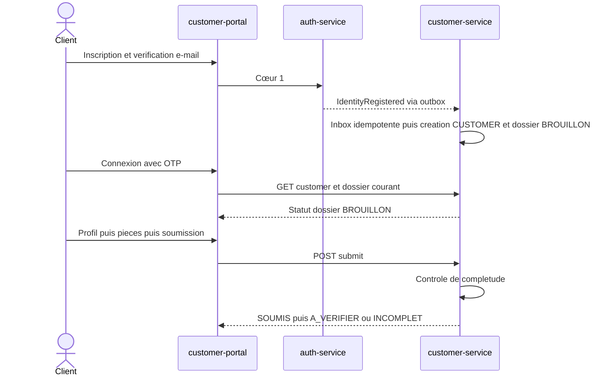
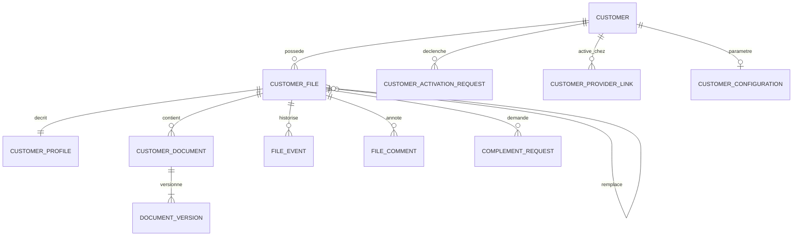
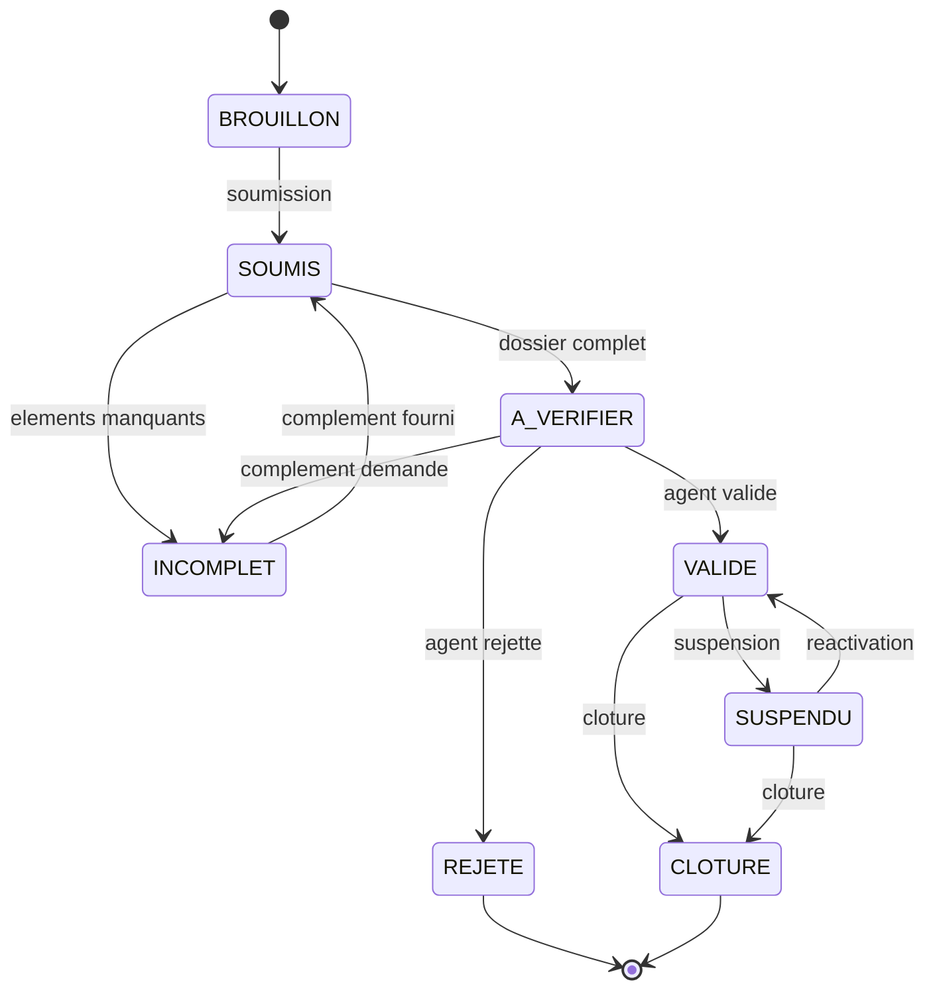

# CDC-02 — Cycle de vie client

**Projet :** KG Pay (Kab Gateway Payment)
**Cœur métier :** 2 — Gestion du cycle de vie client
**Service porteur :** `customer-service` (nouveau)
**Interfaces :** `apps/customer-portal` (dossier du client), `apps/staff-portal` (examen et décisions)
**Version du CDC :** 0.1 — Brouillon pour validation
**Date :** 23 novembre 2026
**Cœur précédent :** CDC-01 — Identité et contrôle des accès
**Condition d'entrée :** recette du cœur 1 conforme à `docs/recette/RECETTE-01-identite-acces.md` (porte G1)
**Sources :** référentiel v0.3 (§5.2, §7.1, annexe A cœur 2, B.1 cœur 2, RP-07, RP-08, RP-09, RP-15), CDC-01, ADR-001 à ADR-005
**ADR liés :** ADR-003 (événements), ADR-004 (documents), ADR-005 (frontend)

**Légende des marqueurs**

- **[RÉFÉRENTIEL]** : établi dans le référentiel v0.3.
- **[DÉCISION]** : choix exprimé par le porteur du projet.
- **[PROPOSITION]** : choix proposé ici, à valider. Les valeurs chiffrées sont des défauts configurables, jamais des engagements.
- **[POINT OUVERT]** : dépend d'une information ou d'une décision manquante.
- **Δ** : modification d'un élément du cœur précédent ou d'un document existant (voir §12).

---

## 1. Résumé exécutif

Le cœur 2 répond à : **qui est le client, et où en est son dossier ?** Il crée le dossier du client dès que son identité est vérifiée (événement `IdentityRegistered`), guide le client dans la complétion de son **profil** et le dépôt de ses **pièces**, organise l'**examen** par le personnel, rend la **décision** (valider, demander un complément, rejeter) et gère la **suspension**, la **réactivation** et la **clôture**. Dans un second incrément (2B), il suivra l'**activation par partenaire et par méthode de paiement**.

Il ne crée pas d'identité ni de session (cœur 1), ne porte ni solde ni opération (cœurs 5, 6, 7), ne fixe pas les obligations réglementaires de connaissance du client (cœur 9, validation juridique) et ne crée pas de compte chez un partenaire : il pilote le dossier et **enregistre le résultat** des démarches [RÉFÉRENTIEL].

**Ce que livre la V1 (incrément 2A)** : création automatique du client, dossier avec profil et pièces, soumission, contrôle de complétude, examen manuel avec décision, historique, suspension / réactivation / clôture, détection de doublons à titre d'alerte, événements vers les autres cœurs, et les deux interfaces (client et personnel). **Incrément 2B** : demandes d'activation et liens client-partenaire, dépend du cœur 3.

## 2. Périmètre

### 2.1 Dans le périmètre V1 (incrément 2A)

- Création du `CUSTOMER` à la réception de `IdentityRegistered`, avec un dossier en `BROUILLON`.
- Profil du client, pièces justificatives, soumission, contrôle de complétude.
- Examen par le personnel : prise en charge simple, commentaires internes, demande de complément, validation, rejet.
- Suspension, réactivation, clôture d'un client (RP-07, RP-08).
- Nouvelle demande après rejet, dossier lié à l'ancien (RP-15).
- Historique complet et non écrasé de chaque dossier.
- Alerte de doublon d'identité (jamais de rejet automatique).
- Statut global dérivé (RP-09).
- Événements du §8.3 ; permissions du §3.2.
- Interfaces client et personnel du §4.6 et de ce CDC (IAM-F-24 devient implémentable).

### 2.2 Incrément 2B (dépend du cœur 3)

Demandes d'activation (`CUSTOMER_ACTIVATION_REQUEST`), liens client-partenaire (`CUSTOMER_PROVIDER_LINK`), activation par méthode, paramètres propres au client (`CUSTOMER_CONFIGURATION`). Le modèle est réservé dès 2A ; il n'est développé que lorsque le référentiel partenaires et méthodes (cœur 3) existe.

### 2.3 Hors périmètre V1

- Comptes bancaires bénéficiaires : le v0.3 les cite au cœur 2 (schéma) et au cœur 7 (liste d'objets). **Recommandation** : propriété fonctionnelle du cœur 7, décidée dans le CDC-07 ; non développés ici [POINT OUVERT 4].
- Niveaux de KYC, contrôles de listes et sanctions, limites par client : cœur 9.
- File de travail générale, escalade, SLA : cœur 10 (le cœur 2 n'offre qu'une affectation simple).
- Réexamen périodique automatique et rappels d'expiration de pièces : P2 (les dates d'expiration sont capturées dès la V1).
- Plusieurs utilisateurs par client, clients entreprises : hors périmètre produit [RÉFÉRENTIEL].
- Notifications riches (SMS, push) : cœur 12.

### 2.4 Frontières : ce que ce cœur ne fait pas [RÉFÉRENTIEL]

- Il ne décide pas de l'éligibilité financière d'une opération (cœurs 5, 7, 9) ; il fournit le statut du client et du dossier.
- Il ne détient pas les identifiants de connexion ni l'e-mail de référence (cœur 1) ; il en garde une **copie de contact** tenue à jour par événement.
- Il ne comptabilise rien.

## 3. Acteurs, rôles et permissions

### 3.1 Acteurs

| Acteur | Rôle dans le cœur 2 |
| --- | --- |
| `CUSTOMER` (sujet du cœur 1) | Complète son dossier, dépose ses pièces, soumet, consulte son statut. N'accède qu'à **son** dossier (propriété vérifiée par `customer-service`). |
| `OPERATIONS_ADMIN` | Examine, commente, demande un complément, valide, rejette, suspend, réactive, clôture. |
| `GLOBAL_SUPER_ADMIN` | Toutes les permissions du catalogue (CDC-01 §3.2). |
| `CONFIGURATION_ADMIN` | Aucun droit sur les dossiers en V1. |

### 3.2 Permissions publiées par ce cœur [Δ catalogue CDC-01]

Format `domaine.ressource.action` (CDC-01 §8.2). Elles sont ajoutées au catalogue versionné de `@kgpay/contracts` (nouvelle version `pv`).

| Permission | CUSTOMER | OPERATIONS_ADMIN | Remarque |
| --- | --- | --- | --- |
| `customer.self.read` | ✔ | — | Lire son client et son dossier. |
| `customer.self.write` | ✔ | — | Compléter, déposer, soumettre. |
| `customer.file.read` | — | ✔ | Lister et consulter les dossiers. |
| `customer.file.assign` | — | ✔ | S'affecter ou affecter un dossier. |
| `customer.file.comment` | — | ✔ | Notes internes. |
| `customer.file.request-complement` | — | ✔ | Demander un complément. |
| `customer.file.validate` | — | ✔ | Valider (step-up). |
| `customer.file.reject` | — | ✔ | Rejeter (step-up). |
| `customer.document.read` | — | ✔ | Lire le contenu d'une pièce (audité, ADR-004 S9). |
| `customer.account.suspend` / `.reactivate` / `.close` | — | ✔ | Cycle de vie du client (step-up). |

`GLOBAL_SUPER_ADMIN` les détient toutes. Les permissions du cœur 2 **ne sont pas** réservées au super-admin : elles deviennent sélectionnables pour les rôles personnalisés, ce qui lève la limite constatée au cœur 1 (« aucun droit sélectionnable », CDC-01 §8.11).

### 3.3 Séparation des responsabilités

- Un client ne peut jamais décider sur son propre dossier (un `CUSTOMER` n'a aucune permission `customer.file.*`).
- RP-10 n'est pas applicable à la validation de dossier en V1 (pas d'étape d'approbation distincte de l'instruction). Une **seconde validation** pour les dossiers sensibles est un point ouvert, à rattacher au cœur 9 [POINT OUVERT 5].

## 4. Parcours principaux

### 4.1 Création du client et du dossier

Si le client se connecte **avant** que l'événement soit traité, `GET /customers/me` répond « en préparation » (état transitoire, voir CUS-F-01) ; le portail réessaie, il ne crée jamais lui-même le client.

### 4.2 Complétion et soumission

1. Le client renseigne son profil (§7.3) et dépose les pièces requises (§7.4). Chaque modification est sauvegardée en brouillon.
2. Il lance la soumission après une **confirmation explicite** (non annulable, ADR-005 F9).
3. Le contrôle de complétude vérifie les champs obligatoires et les pièces requises : **complet** → `A_VERIFIER` ; **incomplet** → `INCOMPLET` avec la liste des manques.
4. À partir de la soumission, le contenu du dossier est **figé** ; seul un complément demandé par le personnel le rouvre pour les éléments concernés.

### 4.3 Examen et décision

1. Un agent s'affecte un dossier `A_VERIFIER`, consulte profil, pièces et alertes de doublon.
2. Il peut commenter en interne, puis : **demander un complément** (→ `INCOMPLET`), **valider** (→ `VALIDE`) ou **rejeter** (→ `REJETE`, motif obligatoire).
3. Valider, rejeter, suspendre, réactiver et clôturer exigent un **step-up** (catégorie `customer-decision`) [Δ CDC-01 §8.6].
4. Chaque décision produit un événement d'historique et un événement vers les autres cœurs.

### 4.4 Complément demandé

L'agent désigne les éléments à compléter (champs ou types de pièces) et rédige un message au client. Le client voit la demande, complète, et soumet à nouveau : le dossier repasse `SOUMIS` → contrôle → `A_VERIFIER`.

### 4.5 Rejet et nouvelle demande

Un dossier `REJETE` est définitif (RP-15). Le client peut ouvrir une **nouvelle demande** : un nouveau dossier `BROUILLON` est créé, lié à l'ancien (`previousFileId`), avec préremplissage du **profil** uniquement ; les pièces sont redéposées. Le nombre de nouvelles demandes est borné par un paramètre.

### 4.6 Suspension, réactivation, clôture

- **Suspension** : bloque toute nouvelle opération et tout versement (RP-07) via l'événement `CustomerSuspended` ; le client reste connecté pour consulter ses opérations en cours (IAM-R-05).
- **Réactivation** : retour à l'état précédent valide.
- **Clôture** : impossible tant qu'un solde non nul, une réservation ou une opération non terminale existe (RP-08). Tant que les cœurs 5, 6 et 7 n'existent pas, le contrôle passe par un port `ClosureEligibility` dont l'adaptateur par défaut déclare « aucune obligation » ; **le CDC-06 remplace cet adaptateur** et ajoute un test de contrat bloquant [POINT OUVERT 3].

### 4.7 Parcours dans les interfaces

**customer-portal** (zone « Mon dossier », `/file`) :

- Trois états affichés **séparément** : *Identité*, *Dossier*, *Activation* (2B, absent en 2A). Une identité active n'est jamais présentée comme un dossier validé (IAM-F-24).
- Assistant en étapes : profil → pièces → vérification → soumission ; indicateur d'enregistrement du brouillon ; liste des manques en cas d'`INCOMPLET`.
- Message de complément du personnel affiché tel quel ; motif de rejet affiché par code traduit.
- Pièces : ajout (caméra sur mobile), aperçu, remplacement, suppression d'un brouillon avec fenêtre annulable de deux secondes (ADR-005 F9).
- Après `REJETE` : action « Nouvelle demande ». Après `SUSPENDU` ou `CLOTURE` : message explicatif, historique en lecture seule.

**staff-portal** (zone « Dossiers clients », `/customers/files`) :

- Liste filtrable (statut, affecté, période), recherche, pagination.
- Fiche : profil, pièces avec visionneuse (contenu chargé à la demande, audité), alertes de doublon, historique, notes internes (jamais visibles du client).
- Actions avec confirmation et step-up : demander un complément, valider, rejeter, suspendre, réactiver, clôturer.
- Les actions non permises sont masquées à titre ergonomique ; le backend contrôle chaque appel.

Toutes les interfaces sont bilingues (FR/EN) et responsive (CDC-01 IAM-F-23).

## 5. Exigences fonctionnelles

Priorités : **P0** indispensable à l'incrément 2A, **P1** souhaitable en 2A, **P2** après 2A, **2B** incrément suivant.

| ID | Exigence | Prio | Critère d'acceptation |
| --- | --- | --- | --- |
| CUS-F-01 | Créer un `CUSTOMER` et un dossier `BROUILLON` à la réception d'`IdentityRegistered`. | P0 | Un seul client par `identityId`, même si l'événement est reçu plusieurs fois ; avant traitement, `GET /customers/me` répond « en préparation ». |
| CUS-F-02 | Tenir à jour la copie de contact (e-mail, téléphone) par événements du cœur 1. | P0 | Après `IdentityContactChanged`, le personnel voit le contact à jour ; le client ne peut pas modifier l'e-mail ici. |
| CUS-F-03 | Saisie du profil en brouillon avec sauvegarde progressive. | P0 | Les champs du §7.3 sont validés côté serveur ; une modification concurrente produit un 409 (ADR-005 F8). |
| CUS-F-04 | Catalogue des pièces requises, versionné, par type de pièce. | P0 | Le contrôle de complétude s'appuie sur le catalogue en vigueur à la création du dossier. |
| CUS-F-05 | Soumission avec contrôle de complétude. | P0 | Dossier complet → `A_VERIFIER` ; incomplet → `INCOMPLET` avec la liste des manques ; après soumission, le contenu est figé. |
| CUS-F-06 | Dépôt de pièces (JPEG, PNG, PDF) conformément à ADR-004. | P0 | Types vérifiés par signature, taille limitée, nom assaini ; un fichier invalide est refusé avec une erreur normalisée. |
| CUS-F-07 | Versions de pièces : un remplacement crée une nouvelle version ; l'ancienne reste consultable par le personnel. | P0 | Aucune pièce d'un dossier soumis n'est supprimée ni écrasée. |
| CUS-F-08 | Lecture de pièces protégée : propriété, permission, `no-store`, jamais d'URL publique ; audit de toute lecture par le personnel. | P0 | Un client ne lit pas la pièce d'un autre ; un agent sans `customer.document.read` est refusé ; chaque lecture produit un événement d'audit. |
| CUS-F-09 | Suppression logique d'une pièce uniquement dans un dossier `BROUILLON`. | P0 | La suppression d'une pièce d'un dossier soumis est refusée. |
| CUS-F-10 | Affectation simple d'un dossier à un agent et notes internes. | P0 | L'affectation et chaque note sont horodatées et attribuées ; le client ne voit jamais les notes internes. |
| CUS-F-11 | Demande de complément structurée (éléments + message). | P0 | Le dossier passe `INCOMPLET` ; le client voit les éléments demandés et le message ; l'historique conserve la demande. |
| CUS-F-12 | Validation d'un dossier. | P0 | Step-up requis ; état `VALIDE` ; événement `CustomerFileValidated` ; l'historique garde instructeur et horodatage. |
| CUS-F-13 | Rejet d'un dossier avec motif obligatoire (code d'une liste fermée + message optionnel au client). | P0 | Step-up requis ; état `REJETE` définitif ; événement `CustomerFileRejected`. |
| CUS-F-14 | Nouvelle demande après rejet, dossier lié (RP-15). | P0 | Nouveau dossier `BROUILLON` avec `previousFileId` ; profil prérempli ; ancien dossier inchangé ; borne de nouvelles demandes respectée. |
| CUS-F-15 | Suspension et réactivation d'un client (RP-07). | P0 | Step-up requis ; `CustomerSuspended` publié ; le client reste connecté en lecture ; réactivation restaure l'état précédent. |
| CUS-F-16 | Clôture d'un client (RP-08) via le port `ClosureEligibility`. | P0 | Refusée si le port signale une obligation ; sinon `CLOTURE` terminal et `CustomerClosed` publié. |
| CUS-F-17 | Statut global dérivé (RP-09) : dossier `VALIDE` et au moins un lien `ACTIVE`. | P0 | En 2A, un client validé apparaît « validé, sans activation » ; l'autorisation reste évaluée par méthode. |
| CUS-F-18 | Historique append-only de chaque dossier (`FILE_EVENT`). | P0 | Chaque transition, décision, complément et lecture sensible y figure ; aucune ligne n'est modifiable ni supprimable. |
| CUS-F-19 | Alerte de doublon d'identité à l'examen. | P1 | Un profil et/ou un numéro de pièce déjà vus déclenche une alerte visible du personnel ; **aucun rejet automatique**. |
| CUS-F-20 | Consommation d'`IdentityDisabled` pour un `CUSTOMER`. | P1 | Le client passe `SUSPENDU` (motif `IDENTITY_DISABLED`), événement émis. |
| CUS-F-21 | Émission d'événements via Transactional Outbox et consommation via inbox idempotente (ADR-003). | P0 | Aucun événement perdu en cas de panne du transport ; un événement rejoué n'a aucun nouvel effet. |
| CUS-F-22 | Notification du client lors des changements d'état du dossier. | P1 | Un e-mail bilingue est envoyé pour complément, validation, rejet (port `Notifier`, adaptateur SMTP, Maildev en développement). Aucune donnée sensible dans le message. |
| CUS-F-23 | Interface client « Mon dossier » (§4.7). | P0 | Couvre les parcours §4.1 à §4.6 ; les trois états sont distincts ; bilingue ; responsive. |
| CUS-F-24 | Interface personnel « Dossiers clients » (§4.7). | P0 | Liste, fiche, actions avec step-up ; permissions respectées côté serveur. |
| CUS-F-25 | Réexamen périodique et alertes d'expiration de pièces. | P2 | Hors 2A ; les dates d'expiration sont déjà stockées. |
| CUS-F-26 | Demandes d'activation et liens client-partenaire par méthode (RP-06, RP-09). | 2B | Cycle `DEMANDEE → EN_COURS → ACTIVE / REFUSEE / SUSPENDUE` ; activation globale et par méthode distinguées ; dépend du cœur 3. |

## 6. Règles métier

### 6.1 Règles du référentiel applicables [RÉFÉRENTIEL]

| Règle | Application |
| --- | --- |
| RP-07 | Un client suspendu ne crée plus d'opération ni de versement ; les opérations en cours sont suivies. Appliquée par les cœurs 5 et 7 à partir de `CustomerSuspended`. |
| RP-08 | Clôture impossible avec solde non nul, réservation ou opération non terminale (port `ClosureEligibility`). |
| RP-09 | Statut global dérivé ; autorisation évaluée par méthode. |
| RP-14 | Événements publiés après persistance (outbox). |
| RP-15 | Dossier rejeté jamais rouvert ; nouvelle demande = nouveau dossier lié. |
| RP-17 | Toute action sensible produit un événement d'audit. |

### 6.2 Règles propres au cœur 2 [PROPOSITION]

| Règle | Énoncé |
| --- | --- |
| CUS-R-01 | Un `identityId` correspond à un seul `CUSTOMER` ; un `CUSTOMER` a un seul dossier **courant**. |
| CUS-R-02 | Après soumission, le contenu d'un dossier est figé. Un complément ne modifie que les éléments demandés et crée de nouvelles versions de pièces. |
| CUS-R-03 | Un dossier `REJETE` ou `CLOTURE` est terminal et n'est jamais modifié. |
| CUS-R-04 | Une décision (valider, rejeter, suspendre, réactiver, clôturer) exige une preuve de step-up valide et produit une entrée d'historique et un événement. |
| CUS-R-05 | Le client n'accède qu'à son propre dossier ; la propriété est vérifiée à chaque requête sur l'`identityId` du jeton, jamais sur un identifiant fourni par le client. |
| CUS-R-06 | Les notes internes ne sont jamais exposées au client ; le message de complément et le motif de rejet sont des champs distincts, destinés au client. |
| CUS-R-07 | Une alerte de doublon informe l'agent ; elle ne bloque ni ne rejette automatiquement. |
| CUS-R-08 | Réactiver un client restaure exactement l'état qu'il avait avant la suspension ; un client `CLOTURE` ne peut pas être réactivé. |
| CUS-R-09 | La clôture d'un client ne désactive pas son identité (cœur 1) ; le portail affiche un état clos en lecture seule [POINT OUVERT 6]. |
| CUS-R-10 | Aucune pièce d'un dossier soumis n'est supprimée physiquement ; la durée de conservation est fixée avec le juridique. |

## 7. Modèle conceptuel et états

### 7.1 Objets métier

`CUSTOMER`, `CUSTOMER_PROFILE`, `CUSTOMER_DOCUMENT`, `CUSTOMER_ACTIVATION_REQUEST`, `CUSTOMER_PROVIDER_LINK`, `CUSTOMER_CONFIGURATION` [RÉFÉRENTIEL]. **Ajoutés** [Δ référentiel] : `CUSTOMER_FILE` (dossier, pour porter RP-15), `DOCUMENT_VERSION`, `FILE_EVENT`, `FILE_COMMENT`, `COMPLEMENT_REQUEST`, `INBOX_EVENT`, `OUTBOX_EVENT`.

### 7.2 États du dossier [RÉFÉRENTIEL v0.2]

`SOUMIS` est un état transitoire : le contrôle de complétude est automatique et immédiat.

**Statut global du client (dérivé, RP-09)**

| Statut global | Condition |
| --- | --- |
| `EN_PREPARATION` | Client créé, dossier `BROUILLON`, `INCOMPLET` ou en examen. |
| `VALIDE_SANS_ACTIVATION` | Dossier `VALIDE`, aucun lien `ACTIVE` (seul cas possible en 2A). |
| `ACTIF` | Dossier `VALIDE` et au moins un lien `ACTIVE` (2B). |
| `SUSPENDU` / `CLOTURE` / `REJETE` | Selon le dossier courant. |

### 7.3 Profil du client [PROPOSITION — à confirmer avec la conformité]

| Champ | Remarque |
| --- | --- |
| Nom, prénoms | Obligatoires. |
| Date de naissance | Obligatoire ; âge minimal configurable (défaut proposé : 18 ans). |
| Nationalité, pays de résidence | Codes pays ISO 3166. |
| Adresse | Ligne, ville, région/province (optionnelle), pays. |
| Pièce d'identité | Type, numéro, pays d'émission, date d'expiration. |
| Contact | Copie de l'e-mail et du téléphone du cœur 1, non modifiables ici. |

Aucune obligation réglementaire n'est présumée : la liste réelle des champs et pièces obligatoires est un paramètre du catalogue versionné et se valide avec la conformité [POINT OUVERT 1].

### 7.4 Catalogue des pièces [PROPOSITION]

Types prévus : pièce d'identité (recto, verso, ou passeport), justificatif de domicile. L'ensemble requis est défini par version du catalogue, dans `@kgpay/contracts`, non modifiable à l'exécution en V1.

## 8. Partie technique

### 8.1 Service et stack [PROPOSITION]

| Élément | Choix |
| --- | --- |
| Service | `customer-service`, NestJS avec Express, TypeScript strict (comme `auth-service`). Créé à la validation de ce CDC (ADR-001 D9). |
| Base | PostgreSQL dédiée, Prisma, schéma propre (ADR-001 D4). |
| Authentification | `@kgpay/auth-guard` : vérification locale des JWT HS256 via le secret partagé runtime et les secrets précédents pendant une rotation ; permissions du §3.2 ; step-up via `@RequireStepUp('customer-decision')`. |
| Événements | ADR-003 : outbox, livraison HTTP signée en V1, inbox idempotente. |
| Documents | ADR-004 : port `DocumentStore`, chiffrement applicatif, lecture contrôlée, audit. |
| Courriels | Port `Notifier` avec adaptateur SMTP ; Maildev en développement ; remplacé par le cœur 12 sans toucher au domaine [POINT OUVERT 2]. |
| Chemin public cible | `/customers/*` (routage d'infrastructure, ADR-002 D5) ; `/internal/*` jamais exposé. |
| Interfaces | ADR-005 : TanStack Query, `packages/ui`, `customerApi`. |

### 8.2 API indicative (non contractuelle)

| Groupe | Chemins indicatifs |
| --- | --- |
| Client | `GET /customers/me`, `GET/PUT /customers/me/file/profile`, `GET /customers/me/file`, `POST /customers/me/file/documents` (multipart), `GET /customers/me/file/documents/{id}/content`, `DELETE /customers/me/file/documents/{id}` (brouillon), `POST /customers/me/file/submit`, `GET /customers/me/file/timeline`, `POST /customers/me/file/reapply` |
| Personnel | `GET /customers/files`, `GET /customers/files/{id}`, `POST /customers/files/{id}/assign`, `.../comments`, `.../request-complement`, `.../validate`, `.../reject`, `GET /customers/files/{id}/documents/{docId}/content` |
| Cycle de vie | `POST /customers/{id}/suspend`, `.../reactivate`, `.../close` |
| Interne | `POST /internal/events` (ADR-003) |
| Exploitation | `GET /health`, `GET /docs-json` (hors production) |

### 8.3 Événements

**Publiés**

| Événement | Moment | Consommateurs prévus |
| --- | --- | --- |
| `CustomerCreated` | Création du client | 13 Audit |
| `CustomerFileSubmitted` | Soumission | 10 Opérations, 12 Notifications, 13 Audit |
| `CustomerFileComplementRequested` | Demande de complément | 12, 13 |
| `CustomerFileValidated` (nom v0.2 : `CustomerValidated`) | Validation | 1 Identité (information), 5, 9, 12, 13 |
| `CustomerFileRejected` | Rejet | 12, 13 |
| `CustomerSuspended` / `CustomerReactivated` | Suspension / réactivation | 5, 7, 9, 12, 13 |
| `CustomerClosed` | Clôture | 5, 6, 7, 13 |
| `CustomerDocumentAccessed` | Lecture d'une pièce par le personnel | 13 |
| `ActivationGranted` (2B) | Activation d'un moyen | 5, 12, 13 |

**Consommés** : `IdentityRegistered`, `IdentityContactChanged` [Δ nouveau, voir §12], `IdentityDisabled` (CUS-F-20).

Les schémas vivent dans `@kgpay/contracts`.

### 8.4 Paramètres configurables et défauts proposés

| Paramètre | Défaut | Remarque |
| --- | --- | --- |
| Âge minimal | 18 ans | À valider (conformité). |
| Nouvelles demandes après rejet | 3 | |
| Taille / nombre de pièces | 5 Mo / 10 | ADR-004. |
| Sauvegarde du brouillon (délai de différé) | 1 s | Côté interface. |
| Intervalle de rafraîchissement du statut | 60 s | Côté interface (ADR-005 F12). |
| Réessais d'événements | Voir ADR-003 | |

### 8.5 Exigences de sécurité et de protection des données

- Contrôle de propriété à chaque requête (CUS-R-05) ; tout identifiant de ressource fourni est vérifié contre l'identité du jeton.
- Champs sensibles (numéro de pièce) protégés ; empreintes de recherche de doublon calculées avec une clé runtime (jamais le numéro en clair dans l'index).
- Aucune donnée personnelle ni contenu de pièce dans les journaux, événements d'audit au-delà des identifiants, ou messages d'erreur.
- Mêmes règles transverses que CDC-01 §8.7 (corrélation, erreurs uniformes, CORS restreint, en-têtes de sécurité).
- Chaque lecture sensible et chaque décision sont auditées (RP-17).

### 8.6 Observabilité

Journaux structurés avec `correlationId`. Métriques minimales : dossiers par état, délai moyen d'examen, événements en `DEAD`, refus de téléversement par motif, erreurs d'inbox. `GET /health` sans authentification.

### 8.7 Stratégie de tests

| Niveau | À couvrir |
| --- | --- |
| Unitaire | Machine d'états (table de transitions autorisées et interdites), contrôle de complétude, statut global dérivé, calcul d'empreinte de doublon, règles RP-15. |
| Intégration | Persistance Prisma, inbox (rejeu), outbox, `DocumentStore` (chiffrement, versions), port `ClosureEligibility`. |
| Contrat | `customer-service` consomme un **vrai** `IdentityRegistered` émis par `auth-service` ; ses jetons sont vérifiés localement avec le secret HS256 runtime partagé, sans appel à `auth-service`. |
| Sécurité | Accès croisé (client A vers dossier ou pièce de B), pièce de type falsifié, fichier trop gros, nom de fichier piégé, décision sans step-up ou avec step-up d'une autre catégorie, lecture de pièce sans permission, injection dans les champs libres. |
| E2E | Parcours §4.1 à §4.6 dans les deux portails (Playwright, ADR-005 F13). |
| Recette | `docs/recette/RECETTE-02-cycle-de-vie-client.md`, à produire après validation de ce CDC avec le même gabarit que RECETTE-01. |

### 8.8 Exigences frontend

- Contrats de transport (schémas Yup et types) dans `@kgpay/contracts/transport` ; validation navigateur ergonomique seulement, validation serveur obligatoire (ADR-002 D3).
- Instance `customerApi` distincte de `authApi` ; aucun journal de corps de requête ni de jeton (ADR-002 §3.1, ADR-005 F1).
- Montants : aucun dans ce cœur.
- Messages d'état et d'erreur traduits par clés i18n ; les textes saisis par l'agent (complément) sont affichés tels quels, échappés.
- Tableaux état → message pour les trois états (identité, dossier, activation) maintenus dans le dépôt (ADR-005 F5).

## 9. Cas limites et exceptions

- **Événement `IdentityRegistered` en retard ou rejoué** : traité une seule fois ; le portail affiche « en préparation » et réessaie.
- **Client qui se désinscrit pendant le brouillon** : hors périmètre ; la clôture suit la procédure de CUS-F-16.
- **Soumission pendant une modification concurrente** (deux onglets) : le contrôle de version renvoie 409.
- **Téléversement interrompu** : aucune version partielle n'est visible ; le client peut réessayer.
- **Document infecté ou illisible** : refusé ou marqué, jamais servi (ADR-004 S8).
- **Agent qui décide sur un dossier qu'il n'a pas affecté** : autorisé si permission ; l'historique garde qui a affecté et qui a décidé.
- **Deux agents décident en même temps** : le contrôle de version garantit qu'une seule décision aboutit.
- **Suspension pendant un dossier en examen** : le dossier garde son état ; les décisions de validation sont refusées tant que le client est suspendu.
- **Réactivation d'un client dont une pièce a expiré** : autorisée ; le réexamen périodique (P2) traitera l'expiration.
- **Doublon probable** : alerte, jamais rejet automatique.
- **Perte d'accès à l'e-mail** : hors cœur 2, traitée au support (CDC-01 §9).
- **Indisponibilité de `customer-service`** : l'authentification continue ; l'espace dossier affiche un état d'erreur sans perte de données saisies.

## 10. Points ouverts

| # | Point ouvert | Recommandation |
| --- | --- | --- |
| 1 | Champs et pièces obligatoires réels, âge minimal. | Valider avec la conformité avant le code ; le catalogue versionné permet d'ajuster sans refonte. |
| 2 | Courriels de statut avant le cœur 12. | Port `Notifier` avec adaptateur SMTP ; envisager l'extraction d'un package technique d'envoi partagé avec `auth-service`. |
| 3 | Contrôle de clôture avant les cœurs 5, 6, 7. | Port `ClosureEligibility` à adaptateur par défaut « aucune obligation », avec test de contrat bloquant au CDC-06. |
| 4 | Propriété des comptes bancaires bénéficiaires. | Cœur 7 propriétaire fonctionnel ; hébergement physique décidé au CDC-07. |
| 5 | Seconde validation des dossiers sensibles. | Cœur 9 (niveaux de risque) ; non requis en V1. |
| 6 | Effet de la clôture sur l'identité. | Identité conservée ; portail en lecture seule ; à confirmer. |
| 7 | Durées de conservation des dossiers et pièces. | À fixer avec le juridique (ADR-004). |
| 8 | Procédure de support pour client ayant perdu son e-mail. | Reprise du point CDC-01 §10.13 ; à définir avant production. |
| 9 | Pré-remplissage du profil après rejet : quels champs ? | Profil seulement en V1 ; pièces à redéposer. |
| 10 | Charge d'examen : affectation automatique ? | Hors V1 ; cœur 10. |

## 11. Critères de recette globaux

L'incrément 2A est recevable lorsque :

1. Un client qui s'inscrit (cœur 1) obtient automatiquement un dossier `BROUILLON`, sans doublon même si l'événement est rejoué.
2. Il complète son profil, dépose ses pièces, soumet ; le dossier est contrôlé et passe `A_VERIFIER` ou `INCOMPLET` avec la liste des manques.
3. Un agent affecté consulte le dossier, lit une pièce (lecture auditée), demande un complément ; le client complète et soumet à nouveau.
4. Un agent valide avec step-up ; le client voit « validé, sans activation » ; l'identité n'est jamais présentée comme un dossier validé.
5. Un rejet est définitif ; une nouvelle demande crée un dossier lié, sans modifier l'ancien.
6. Suspension, réactivation et clôture respectent RP-07 et RP-08 ; `CustomerSuspended` et `CustomerClosed` sont publiés.
7. Un client ne peut ni lire, ni modifier, ni voir les pièces d'un autre client ; un agent sans permission est refusé ; une décision sans step-up valide est refusée.
8. Un fichier de type falsifié, trop gros ou à nom piégé est refusé ; aucun contenu de pièce n'apparaît dans les journaux.
9. Aucun événement n'est perdu si `customer-service` est indisponible puis redémarré (outbox, réessais, inbox).
10. Les deux portails fonctionnent en FR et EN, sur mobile et desktop, avec les états d'erreur et de réseau du cœur 1.
11. `customer-service` démarre seul avec ses seules variables runtime et refuse de démarrer si la configuration est invalide (ADR-001 §5).
12. La recette RECETTE-02 est exécutée et ses résultats sont consignés dans `docs/journal/<date>/`.

## 12. Impacts, delta par rapport au cœur précédent et journal

### 12.1 Delta par rapport au cœur 1

| Élément modifié ou complété | Cœur 1 / document | Modification |
| --- | --- | --- |
| Événement `IdentityRegistered` | CDC-01 §8.3 | Le payload doit porter `identityId`, `subjectType`, e-mail, téléphone de contact et langue préférée ; chaque donnée personnelle est justifiée dans le schéma (ADR-003 §4). |
| Nouvel événement `IdentityContactChanged` | CDC-01 §8.3 | Publié lors d'un changement d'e-mail ou de téléphone, pour tenir à jour la copie du cœur 2. |
| Catalogue de permissions | CDC-01 §8.2, §8.11 | Ajout des permissions `customer.*` ; elles sont sélectionnables dans les rôles personnalisés (la limite « aucun droit sélectionnable » est levée). |
| Actions sensibles | CDC-01 §8.6 | Ajout de la catégorie de step-up `customer-decision` (valider, rejeter, suspendre, réactiver, clôturer). |
| IAM-F-24 | CDC-01 §5 | Devient implémentable : le portail client affiche le statut du dossier fourni par `customer-service`. |
| IAM-F-25 | CDC-01 §5, §10 point 9 | Premier usage réel : suppression d'une pièce en brouillon, fenêtre de deux secondes (ADR-005 F9). |
| Absence de `GET /auth/me` | CDC-01 §8.11 | À traiter : l'e-mail courant doit être affichable dans « Mon dossier » ; soit ajout de `GET /auth/me`, soit usage de la copie de contact du cœur 2. **Recommandation** : copie de contact, sans nouvel endpoint. |
| Chaînage du transport | CDC-01 §8.1 | Le relay local journalisant devient l'adaptateur de développement ; ajout de `HttpSignedTransport` (ADR-003). |
| `lockedUntil` non exposé | CDC-01 §8.11 | Hors cœur 2 ; reste une limite du cœur 1, à traiter si l'administration l'exige. |

### 12.2 Écarts à reporter dans le référentiel (v0.4)

1. Ajouter `CUSTOMER_FILE` (dossier) et son lien `previousFileId` au modèle du cœur 2.
2. Préciser la propriété des comptes bancaires bénéficiaires (cœur 7).
3. Ajouter les événements du §8.3 au catalogue d'événements (v0.2 §1.2) ; renommer `CustomerValidated` en `CustomerFileValidated`.
4. Ajouter les règles CUS-R-01 à CUS-R-10.
5. Ajouter le statut global dérivé du §7.2.

### 12.3 Impacts sur les cœurs suivants

| Cœur | Impact |
| --- | --- |
| 3 Référentiel partenaires | Fournit le catalogue partenaires/méthodes nécessaire à l'incrément 2B. |
| 5 Orchestration | Consomme `CustomerFileValidated`, `CustomerSuspended`, `CustomerClosed` ; refuse toute opération d'un client suspendu ou clos (RP-07). |
| 6 Comptes | Implémente `ClosureEligibility` (RP-08) ; consomme `CustomerClosed`. |
| 7 Versements | Consomme `CustomerSuspended` ; héberge les bénéficiaires bancaires (recommandation). |
| 9 Risque | Consomme `CustomerFileValidated` ; prend en charge niveaux de KYC, listes et seconde validation. |
| 10 Opérations | Reprend l'affectation et les files de travail ; consomme `CustomerFileSubmitted`. |
| 12 Notifications | Reprend les courriels (port `Notifier`) ; consomme les événements de statut. |
| 13 Audit | Reçoit `CustomerDocumentAccessed` et les événements de décision. |

### 12.4 Journal des décisions du cœur 2

| Décision | Origine |
| --- | --- |
| Service `customer-service` dédié, créé à la validation du CDC | [PROPOSITION] (ADR-001 D9) |
| Interfaces client et personnel dans le même CDC que le backend | [DÉCISION] (ADR-002 D1) |
| Objet `CUSTOMER_FILE` pour porter RP-15 | [PROPOSITION] |
| Incrément 2A (dossier) puis 2B (activation partenaire) | [PROPOSITION] |
| Catalogue de pièces versionné, statique en V1 | [PROPOSITION] |
| Step-up `customer-decision` sur les décisions | [PROPOSITION] |
| Comptes bancaires bénéficiaires hors cœur 2 | [PROPOSITION] |
| Transport d'événements, stockage des documents, frontend | ADR-003, ADR-004, ADR-005 [PROPOSITION] |
