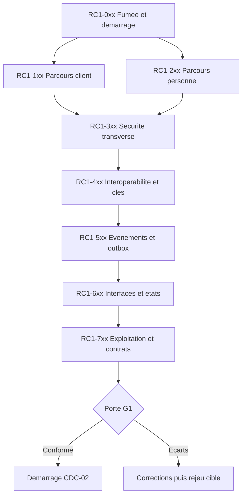

# RECETTE-01 — Cœur 1 : Identité et contrôle des accès

**Projet :** KG Pay (Kab Gateway Payment)
**Cœur testé :** 1 — `auth-service`, `apps/customer-portal`, `apps/staff-portal`
**Version du plan :** 0.1 — Brouillon pour validation
**Date :** 23 novembre 2026
**Référence :** CDC-01 (critères §11, exigences IAM-F-01 à IAM-F-26, règles IAM-R-01 à IAM-R-10), ADR-001 §5, ADR-002
**Objectif :** démarrer l'ensemble (base de données, Maildev, `auth-service`, deux portails), exécuter un parcours de test complet et décider si l'on peut **passer au CDC-02**.
**Ce document sert aussi de gabarit** pour `RECETTE-02` et les recettes suivantes (voir §10).

**Modes d'exécution :** **M** = manuel (navigateur ou outil HTTP) · **A** = automatisable (API ou navigateur piloté) · **M/A** = manuel d'abord, à automatiser ensuite. La stratégie d'automatisation est au §9.

---

## 1. Conventions

### 1.1 Statuts et gravité

| Statut d'un test | Sens |
| --- | --- |
| PASS | Résultat attendu observé, preuve jointe. |
| FAIL | Résultat différent ; une anomalie est ouverte. |
| BLOCKED | Impossible à exécuter (prérequis manquant). |
| N/A | Non applicable, justification obligatoire. |
| REPORTÉ | Limite connue acceptée (§8) avec responsable et échéance. |

| Gravité d'une anomalie | Définition | Effet sur la porte G1 |
| --- | --- | --- |
| **Bloquante** | Faille de sécurité, perte de données, impossibilité d'un parcours P0. | Interdit le passage. |
| **Majeure** | Écart fonctionnel P0 avec contournement ou écart P1 important. | Corrigée avant G1, ou acceptée par écrit. |
| **Mineure** | Écart d'ergonomie, de texte ou de cosmétique. | N'empêche pas G1 ; inscrite au journal. |

### 1.2 Priorités

P0 = indispensable pour passer au CDC-02 · P1 = attendu, un écart peut être accepté par écrit · P2 = souhaitable, non bloquant.

## 2. Environnement de recette

### 2.1 Composants et adresses par défaut

Les valeurs ci-dessous sont des **défauts habituels à vérifier dans le dépôt** (README d'`auth-service`, `.env.example`). Toute différence se note au §2.4.

| Composant | Rôle | Adresse par défaut |
| --- | --- | --- |
| PostgreSQL | Base d'`auth-service` | `localhost:5432` |
| Maildev | Serveur SMTP local et boîte de réception | SMTP `1025`, interface web `http://localhost:1080` |
| `auth-service` | Backend du cœur 1 | `AUTH_BASE_URL` (à relever dans la configuration) |
| `customer-portal` | Interface client | `http://localhost:5173` |
| `staff-portal` | Interface personnel | `http://localhost:5174` |

### 2.2 Ordre de démarrage

1. **PostgreSQL** (local ou Docker) accessible, base vide dédiée `auth-service`.
2. **Maildev** démarré ; vérifier l'interface web.
3. **Environnement** : renseigner `.env` racine depuis `.env.example`, puis générer les fichiers ciblés avec `pnpm env:generate` (ADR-001 §5).
4. **Migrations Prisma** de `auth-service`, selon son README.
5. **Création du premier `GLOBAL_SUPER_ADMIN`** par la commande CLI ponctuelle d'`auth-service` (IAM-F-20).
6. **`auth-service`** démarré.
7. **`customer-portal`** et **`staff-portal`** démarrés.
8. Exécuter la **fumée** du §4 avant tout autre test.

### 2.3 Profil de recette (paramètres raccourcis)

Certains tests dépendent de durées longues (OTP 5 min, verrouillage 15 min, access token 10 min, inactivité 90 jours). Un **profil de recette** raccourcit ces valeurs **sans changer le code**. Relever les noms exacts des variables dans `services/auth-service/env.schema.json`.

| Paramètre (défaut CDC-01 §8.5) | Valeur de recette suggérée | Tests concernés |
| --- | --- | --- |
| Durée de l'access token (10 min) | 30 s | RC1-118, RC1-110 |
| Durée de validité d'un OTP (5 min) | 30 s | RC1-108 |
| Délai de renvoi d'OTP (60 s) | 5 s | RC1-109 |
| Échecs avant verrouillage (5) | 5 (inchangé) | RC1-117 |
| Durée du 1er verrouillage (15 min) | 30 s | RC1-117 |
| Validité d'une invitation (48 h) | 30 s | RC1-202 |
| Validité d'une preuve de step-up (5 min) | 15 s | RC1-211 |
| Inactivité avant désactivation staff (90 jours) | 1 minute | RC1-214 |
| Période de chevauchement de clé (jusqu'à 90 jours) | 1 minute | RC1-402 |

Le profil de recette **ne s'applique jamais** en production. Les tests de production se rejouent avec les valeurs réelles (§8, G2).

### 2.4 Fiche d'environnement (à remplir)

| Élément | Valeur relevée |
| --- | --- |
| Commit testé | |
| Date et heure (UTC) | |
| Testeur | |
| `AUTH_BASE_URL` | |
| Version de Node / pnpm | |
| Profil de recette appliqué (oui/non, valeurs) | |
| Navigateurs et tailles d'écran utilisés | |

### 2.5 Données de test

- Adresses de la forme `client.rc01+NN@kgpay.test` et `staff.rc01+NN@kgpay.test` ; Maildev capte tout.
- Lecture des codes : interface `http://localhost:1080` ou son API (`GET /email`), utile à l'automatisation.
- Mot de passe de test conforme à la politique (≥ 10 caractères, absent de la liste des mots courants) ; **un mot de passe de recette ne sert jamais ailleurs**.
- Ne jamais coller un code OTP, un mot de passe ou un jeton dans un rapport ; les masquer dans les captures.

## 3. Aperçu du parcours

Ordre recommandé : 0xx → 1xx et 2xx (parallèles) → 3xx → 4xx → 5xx → 6xx → 7xx. Un échec bloquant en 0xx arrête la recette.

## 4. Fumée et démarrage (RC1-0xx)

| ID | Prio | Mode | Scénario | Résultat attendu | Couvre |
| --- | --- | --- | --- | --- | --- |
| RC1-001 | P0 | M/A | Vérifier l'état des migrations Prisma de la base. | Aucune migration en attente ; schéma conforme. | CDC-01 §8.1 |
| RC1-002 | P0 | M | Ouvrir l'interface Maildev et envoyer un message SMTP de test. | Le message apparaît. | CDC-01 §10.1 |
| RC1-003 | P0 | M/A | Vérifier les fichiers `.generated/env/<workspace>.env` pour `auth-service` et les deux portails. | Un seul fichier par workspace, généré depuis son schéma et ignoré par Git ; aucun fichier séparé `.build.env` ou `.runtime.env` n'est requis. | ADR-001 §5 ; CDC-01 §11.12 |
| RC1-004 | P0 | M/A | Démarrer `auth-service` puis appeler `GET /health` **sans authentification**. | Réponse de santé positive. | CDC-01 §8.8 |
| RC1-005 | P0 | M/A | Retirer une variable requise (ou fournir une valeur invalide) et démarrer. | Le service **refuse de démarrer** avec un message d'erreur de configuration sans valeur secrète. Restaurer ensuite. | CDC-01 §11.12 |
| RC1-006 | P0 | M/A | Après connexion, inspecter l'en-tête du JWT et les réponses HTTP. | `alg` vaut `HS256`, aucun `kid` n'est requis, et aucune réponse ne divulgue le secret de signature. | IAM-F-05, IAM-F-06 |
| RC1-007 | P1 | M/A | Appeler `GET /docs-json` et ouvrir `/docs` en profil développement ; les rappeler en profil production. | Disponibles en développement ; **désactivés** en production. | ADR-002 §10 |
| RC1-008 | P0 | M | Ouvrir chaque portail à son adresse. | Les deux pages d'accueil de connexion s'affichent sans erreur console bloquante. | IAM-F-22 |
| RC1-009 | P0 | M/A | Depuis chaque origine de portail, émettre une requête préliminaire CORS vers `auth-service` ; répéter depuis une origine non déclarée. | Origines déclarées acceptées ; origine inconnue refusée. | CDC-01 §8.7 ; ADR-002 §11 |
| RC1-010 | P0 | M | Vérifier la création du premier `GLOBAL_SUPER_ADMIN` par CLI (étape 5 de §2.2). | Création sans mot de passe par défaut ; mot de passe défini par la procédure ; **aucun secret** affiché dans les journaux ; un second lancement ne crée pas de second compte privilégié non voulu. | IAM-F-20 |

## 5. Parcours client (RC1-1xx)

Portail : `customer-portal`. Vérifier l'API et l'interface pour chaque scénario lorsque l'ergonomie est concernée.

| ID | Prio | Mode | Scénario | Résultat attendu | Couvre |
| --- | --- | --- | --- | --- | --- |
| RC1-101 | P0 | M/A | S'inscrire avec e-mail, téléphone et mot de passe valides. | Identité en `PENDING_VERIFICATION` ; un courriel de vérification d'e-mail arrive dans Maildev ; le téléphone est enregistré comme **contact non vérifié**. | IAM-F-01 |
| RC1-102 | P0 | M/A | S'inscrire avec un e-mail déjà utilisé. Comparer la réponse et le délai avec une inscription d'un nouvel e-mail. | Message **uniforme** ; aucune indication que le compte existe ; délais comparables. | IAM-F-02, IAM-R-02 |
| RC1-103 | P0 | M/A | S'inscrire avec un mot de passe trop court puis avec un mot de passe courant. | Les deux sont refusés avec une erreur de validation ; aucun mot de passe en clair en base ni dans les journaux. | IAM-F-07 |
| RC1-104 | P0 | M/A | Saisir le code de vérification reçu. | Identité `ACTIVE` ; l'événement `IdentityRegistered` apparaît en outbox (voir RC1-501). | IAM-F-01, IAM-F-17 |
| RC1-105 | P0 | M/A | Se connecter avec e-mail et mot de passe valides. | Un défi OTP est créé et le code arrive par e-mail ; **aucun jeton de session** n'est émis avant validation du code. | IAM-F-04, IAM-F-10 |
| RC1-106 | P0 | M/A | Se connecter avec un mot de passe faux, puis avec un e-mail inconnu. | **Même message** d'erreur dans les deux cas ; aucune différence observable (contenu, code, délai). | IAM-F-04, IAM-R-02 |
| RC1-107 | P0 | M/A | Saisir le bon code OTP. | Un access token est reçu (conservé **en mémoire** côté navigateur) ; le refresh token est dans un cookie `HttpOnly` limité au chemin d'authentification, avec cookie CSRF associé. L'attribut `Secure` se contrôle en HTTPS (voir RC1-705). | IAM-F-05, CDC-01 §8.10 |
| RC1-108 | P0 | M/A | Tester : (a) code faux ×5 ; (b) code expiré ; (c) code déjà utilisé ; (d) code de vérification d'e-mail utilisé comme code de connexion. | Chaque cas est **refusé** ; après 5 essais le défi est invalidé ; aucun code n'est journalisé ; un code d'une autre finalité ne valide jamais le défi de connexion. | IAM-F-10, CDC-01 §9 |
| RC1-109 | P1 | M/A | Demander le renvoi du code deux fois de suite, puis dépasser le plafond horaire. | Délai minimal entre deux envois ; plafond horaire appliqué ; message clair côté interface. | CDC-01 §8.5 |
| RC1-110 | P0 | M/A | Appeler le refresh ; réutiliser ensuite l'**ancien** refresh token. | Le premier refresh renvoie une nouvelle paire ; la réutilisation de l'ancien **révoque toute la famille de sessions** et crée un `ACCESS_EVENT` d'alerte ; la session en cours ne peut plus se rafraîchir. | IAM-F-05, IAM-R-03 |
| RC1-111 | P1 | M/A | Ouvrir deux sessions. Lister les sessions, en révoquer une, puis toutes. | La liste est exacte ; une session révoquée refuse le refresh ; la révocation globale invalide toutes les autres. | IAM-F-11 |
| RC1-112 | P0 | M | Se déconnecter, puis se déconnecter globalement depuis une autre session. | La session est terminée ; le portail revient à la connexion ; le cookie de refresh est supprimé. | IAM-F-11 |
| RC1-113 | P0 | M/A | « Mot de passe oublié » avec un e-mail connu puis inconnu ; terminer la réinitialisation dans les deux portails. | Réponse **uniforme** pour les deux e-mails ; le code est à usage unique, borné dans le temps et limité en essais ; après réinitialisation, **toutes les autres sessions sont révoquées**, l'utilisateur revient à la connexion et voit une confirmation. | IAM-F-09, IAM-R-08, CDC-01 §4.6 |
| RC1-114 | P0 | M/A | Changer son mot de passe en étant connecté. | Les sessions sont révoquées ; le portail renvoie vers la connexion (comportement documenté). | IAM-F-09 |
| RC1-115 | P0 | M/A | Changer son e-mail : step-up, code envoyé à la **nouvelle** adresse, vérification. | Le changement n'est effectif qu'après vérification ; les autres sessions sont révoquées ; événement d'audit présent. | IAM-R-08, CDC-01 §9 |
| RC1-116 | P1 | M/A | Changer le téléphone de contact (step-up). | Aucun moyen d'authentification n'est modifié ; le téléphone reste **non vérifié** et inutilisable pour se connecter. | CDC-01 §4.1 |
| RC1-117 | P0 | M/A | Saisir 5 mots de passe faux consécutifs ; réessayer avec le **bon** mot de passe ; attendre la fin du verrouillage ; déclencher un second verrouillage. Dépasser séparément la limite de tentatives par IP. | Connexion refusée pendant le verrouillage même avec le bon mot de passe ; la durée augmente au verrouillage suivant ; la limite par IP est appliquée ; la réponse ne permet pas d'énumérer les comptes. | IAM-F-08 |
| RC1-118 | P0 | M/A | Décoder l'access token ; attendre son expiration puis appeler un endpoint protégé. | Claims conformes (`iss`, `aud`, `sub`, `sid`, `typ`, `roles`, `pv`, `amr`, `exp`, `jti`) ; **aucune donnée personnelle** (e-mail, téléphone, nom) ; jeton expiré refusé. | CDC-01 §8.2, IAM-R-10 |

## 6. Parcours personnel (RC1-2xx)

Portail : `staff-portal`. Le compte `GLOBAL_SUPER_ADMIN` est celui créé en RC1-010. Prévoir un second compte STAFF avec le rôle `OPERATIONS_ADMIN` créé en RC1-202/203.

| ID | Prio | Mode | Scénario | Résultat attendu | Couvre |
| --- | --- | --- | --- | --- | --- |
| RC1-201 | P0 | M/A | Se connecter en super-admin : mot de passe puis OTP. | Aucune session complète avant l'OTP ; accès à l'administration après. | IAM-F-04, IAM-F-10 |
| RC1-202 | P0 | M/A | Inviter un collaborateur (step-up requis), rôle `OPERATIONS_ADMIN`. Tester : lien à usage unique, expiration, renvoi d'invitation. | Courriel d'invitation reçu (lien si `STAFF_PORTAL_URL__AUTH_SERVICE` est configurée, sinon jeton utilisable manuellement) ; second usage refusé ; invitation expirée refusée ; renvoi fonctionnel ; identité `INVITED`. | IAM-F-03 |
| RC1-203 | P0 | M/A | Accepter l'invitation : définir le mot de passe, vérifier l'e-mail, puis se connecter avec OTP. | Identité `ACTIVE`, événement d'activation émis ; sans OTP valide, aucune session complète. | IAM-F-03, IAM-R-07 |
| RC1-204 | P0 | M/A | Avec le compte `OPERATIONS_ADMIN`, appeler des routes `/admin/*`. | **Refus** (autorisation) ; les entrées d'administration sont masquées dans le portail ; le backend refuse même sans passer par l'interface. | IAM-F-12, CDC-01 §3.3 |
| RC1-205 | P0 | M/A | Attribuer puis retirer un rôle à un STAFF ; tenter (a) de s'attribuer un rôle à soi-même, (b) d'attribuer un rôle STAFF à un CUSTOMER, (c) de désactiver ou retirer le rôle du **dernier** super-admin. | Attribution et retrait fonctionnent et sont audités ; (a), (b), (c) sont **refusés**. | IAM-F-13, IAM-R-06, CDC-01 §9 |
| RC1-206 | P1 | M/A | Créer un rôle personnalisé : tenter une permission inconnue ; tenter une permission d'administration des identités. | Permission inconnue refusée ; permissions d'administration **exclues** des rôles personnalisés ; le formulaire reflète qu'aucun droit n'est sélectionnable avec le catalogue actuel (limite connue, §8). | IAM-F-12 |
| RC1-207 | P0 | M/A | Suspendre un STAFF actif connecté ; tenter une action avec son jeton existant ; réactiver ; puis désactiver ; tenter de réactiver. | La suspension **révoque immédiatement** les sessions ; connexion refusée pendant la suspension ; réactivation possible ; la désactivation est **terminale**. | IAM-F-15, IAM-R-04 |
| RC1-208 | P0 | M/A | Verrouiller un compte (voir RC1-117) puis le déverrouiller manuellement avec step-up. | Le déblocage rétablit la connexion et produit un événement d'audit. | IAM-F-15 |
| RC1-209 | P1 | M/A | Consulter le journal des accès et la revue des accès. | Les connexions réussies/échouées, verrouillages, réutilisations de refresh y figurent avec identité, type, résultat, IP, user-agent, horodatage UTC, `correlationId` ; **aucun secret**. | IAM-F-16 |
| RC1-210 | P1 | M/A | Récupération d'e-mail d'un STAFF par le super-admin avec step-up. | La procédure aboutit, est auditée ; un non-super-admin ne peut pas l'exécuter. | CDC-01 §9 |
| RC1-211 | P0 | M/A | Obtenir une preuve de step-up pour une catégorie A ; la présenter pour la catégorie B ; la présenter après expiration ; la présenter depuis une **autre session** ; la rejouer. | Catégorie B refusée ; expirée refusée ; autre session refusée ; rejeu refusé (usage unique côté consommateur). | IAM-F-14, IAM-R-09 |
| RC1-212 | P0 | M/A | Une action sensible sans preuve de step-up (inviter, attribuer un rôle, suspendre). | **Refusée** ; l'interface demande la preuve. | IAM-F-14, CDC-01 §8.6 |
| RC1-213 | P1 | M/A | Appeler `POST /internal/introspect` avec et sans qualité de service autorisé, sur une session active puis révoquée. | Refusé à l'appelant non autorisé ; actif/inactif et rôles courants exacts pour l'autorisé. | IAM-F-18 |
| RC1-214 | P1 | A | Avec le profil de recette, laisser un STAFF inactif au-delà du seuil raccourci, puis lancer la revue/désactivation périodique. | Le compte est désactivé et l'événement émis. | IAM-F-19 |
| RC1-215 | — | — | **RP-10 (approbateur ≠ demandeur ≠ instructeur)** : N/A ici ; appliquée aux cœurs 7 et 10. Vérifier seulement que l'`identityId` est stable et unique. | N/A justifié. | CDC-01 §6.1 |

## 7. Sécurité transverse, clés, événements, interfaces, exploitation

### 7.1 Sécurité transverse (RC1-3xx)

| ID | Prio | Mode | Scénario | Résultat attendu | Couvre |
| --- | --- | --- | --- | --- | --- |
| RC1-301 | P0 | A | Mesurer réponse et délai pour : e-mail connu/inconnu en connexion, inscription, mot de passe oublié. | Aucune différence exploitable (message, code HTTP, ordre de grandeur du délai). | IAM-R-02 |
| RC1-302 | P0 | A | Présenter un jeton falsifié, signé avec un algorithme autre que HS256 (`HS384` ou `none`), ou modifié après signature. | **Tous refusés**. | CDC-01 §8.9 |
| RC1-303 | P0 | M/A | Après l'exécution complète de la recette, rechercher dans les journaux d'`auth-service`, de Maildev (hors corps des courriels de test) et du navigateur : mots de passe, codes OTP, refresh tokens, jetons complets. | **Aucune occurrence**. Le relay d'outbox ne journalise ni payload ni secret. | CDC-01 §8.7, §11.11 |
| RC1-304 | P0 | M/A | Inspecter les lignes d'outbox : contenu des payloads. | Pas de secret ; données personnelles limitées au contrat de l'événement. | IAM-R-10 |
| RC1-305 | P1 | A | Examiner les en-têtes de réponse (sécurité, CORS, cache) sur les routes d'authentification. | En-têtes de sécurité présents ; CORS restreint ; pas de mise en cache des réponses d'authentification. | CDC-01 §8.7 |
| RC1-306 | P0 | A | Avec l'utilisateur A, tenter de lire ou révoquer une session de l'utilisateur B (identifiant deviné). | **Refusé** (403 ou 404) et journalisé ; B inchangé. | CDC-01 §8.7 |

### 7.2 Interopérabilité et clés (RC1-4xx)

| ID | Prio | Mode | Scénario | Résultat attendu | Couvre |
| --- | --- | --- | --- | --- | --- |
| RC1-401 | P0 | A | Un script externe (spécification : `scripts/recette/verify-shared-secret`, à créer) vérifie un jeton réel **sans appeler** `auth-service`, avec le secret runtime configuré pour le service consommateur. | Signature HS256, `iss`, `aud`, `exp` validés localement ; le même contrôle sert de test de contrat pour `@kgpay/auth-guard`. | IAM-F-06, CDC-01 §11.3 |
| RC1-402 | P0 | M/A | Déclencher une rotation en configurant l'ancien secret dans `JWT_SIGNING_PREVIOUS_SECRETS_JSON`. Vérifier un jeton émis **avant** et un jeton émis **après**. | Les deux sont valides pendant le chevauchement ; après expiration des jetons signés avec l'ancien secret, celui-ci peut être retiré sans interrompre les sessions. | IAM-F-06, CDC-01 §11.4 |
| RC1-403 | P0 | M/A | Arrêter `auth-service` ; vérifier un jeton déjà émis avec le secret local du service consommateur ; tenter une connexion depuis le portail. | Le jeton reste vérifiable localement ; la connexion échoue proprement avec un état d'erreur lisible, sans perte de saisie ni boucle de requêtes. | CDC-01 §9 |

### 7.3 Événements et outbox (RC1-5xx)

| ID | Prio | Mode | Scénario | Résultat attendu | Couvre |
| --- | --- | --- | --- | --- | --- |
| RC1-501 | P0 | M/A | Après les parcours 101 à 118 et 201 à 214, lister l'outbox. | Les événements attendus (CDC-01 §8.3) y figurent, chacun écrit avec le changement d'état qu'il décrit ; `IdentityRegistered` n'existe qu'après vérification de l'e-mail ; le payload d'`IdentityRegistered` est relevé pour préparer le CDC-02 (e-mail, téléphone, langue : voir CDC-02 §12.1). | IAM-F-17, IAM-F-21 |
| RC1-502 | P0 | M/A | Interrompre l'émission des événements (transport indisponible), exécuter des connexions et une inscription, puis rétablir. | L'authentification **continue de fonctionner** ; les événements s'accumulent dans l'outbox et sont livrés (ou journalisés par le relay local) au rétablissement, sans perte. | IAM-F-17, CDC-01 §11.10 |

### 7.4 Interfaces et états (RC1-6xx)

À exécuter dans **les deux portails** et aux largeurs 360, 768 et 1280 px.

| ID | Prio | Mode | Scénario | Résultat attendu | Couvre |
| --- | --- | --- | --- | --- | --- |
| RC1-601 | P0 | M/A | Langue du navigateur en français puis en anglais, puis autre langue ; changer manuellement ; recharger. | Détection de la langue avec repli sur le français ; choix mémorisé (`kgpay.locale`) ; libellés, erreurs et instructions MFA traduits partout. | IAM-F-23 |
| RC1-602 | P0 | M | Parcourir chaque écran clé aux trois largeurs. | Aucune troncature bloquante ; formulaires et navigation utilisables au clavier et au tactile. | IAM-F-23 |
| RC1-603 | P1 | M | Basculer entre thème clair (B) et sombre (A) ; supprimer la préférence ; changer le thème du système. | Préférence mémorisée (`kgpay.theme`) ; sans préférence, le thème du système est suivi. | ADR-002 §13 |
| RC1-604 | P1 | M | Ouvrir une URL inconnue dans chaque portail. | Page KG Pay « introuvable » bilingue. | IAM-F-26 |
| RC1-605 | P1 | M | Passer le navigateur hors ligne puis en ligne pendant une session. | Vue hors ligne puis vue de rétablissement avec **rechargement déclenché par l'utilisateur** ; aucune requête n'est rejouée automatiquement. | IAM-F-26 |
| RC1-606 | P0 | M | Inspecter le stockage du navigateur (Cache Storage, `localStorage`, `sessionStorage`, IndexedDB) après connexion. | Le Service Worker ne met en cache que le document d'entrée et les ressources statiques ; **aucune** réponse d'API, donnée d'identité ou jeton persisté ; l'access token n'est ni en `localStorage` ni en `sessionStorage`. | IAM-F-26, CDC-01 §8.10 |
| RC1-607 | P0 | M | Recharger la page connectée. | La session est reconstituée par le refresh (cookie + CSRF) sans ressaisie, une seule fois même avec plusieurs onglets. | ADR-002 §11 |
| RC1-608 | P0 | M/A | Sur la même origine, ouvrir les portails CUSTOMER et STAFF, se connecter dans chacun, puis rafraîchir et déconnecter un portail. | Chaque portail conserve sa propre session ; ses cookies refresh/CSRF ne remplacent ni ne révoquent ceux de l'autre. Confirmer le scénario dans les deux sens et vérifier le retour à la connexion seulement dans le portail déconnecté. | CDC-01 §4.6, §10 point 10 ; ADR-002 D12 |
| RC1-608 | P0 | M | Parcourir l'espace client connecté. | **Aucun statut de dossier client** n'est affiché ; l'état d'identité n'est jamais présenté comme preuve de validation du dossier. | IAM-F-24 |
| RC1-609 | P1 | M | Ouvrir la console réseau et la console du navigateur pendant les parcours. | Aucun mot de passe, code OTP ni jeton dans les requêtes journalisées de l'application ni dans la console. | ADR-002 §3.1 |
| RC1-610 | P0 | M/A | Dans le portail personnel, comparer la navigation d'un `GLOBAL_SUPER_ADMIN` et d'un `OPERATIONS_ADMIN`. | L'administration n'est visible que pour le super-admin ; le backend refuse néanmoins l'accès direct (RC1-204). | CDC-01 §8.11 |
| RC1-611 | P1 | M | Vérifier qu'aucune action n'est annulable après deux secondes dans le cœur 1. | Aucune fenêtre d'annulation active (IAM-F-25 ne s'applique pas au cœur 1). | IAM-F-25 |
| RC1-612 | P1 | M | Contrôle d'accessibilité de base : navigation clavier, libellés des champs, focus visible, contraste. | Parcours d'authentification réalisable au clavier ; champs étiquetés. | IAM-F-23 |

### 7.5 Exploitation et contrats (RC1-7xx)

| ID | Prio | Mode | Scénario | Résultat attendu | Couvre |
| --- | --- | --- | --- | --- | --- |
| RC1-701 | P0 | M/A | Recréer une base vide et rejouer toutes les migrations ; les rejouer une seconde fois. | Succès ; seconde exécution sans effet ; données de seed (rôles, catalogue) présentes. | CDC-01 §8.1 |
| RC1-702 | P1 | A | Comparer la collection Postman (37 opérations depuis le 25 novembre) au document `/docs-json`. | Aucune opération manquante ni obsolète ; sinon synchroniser (ADR-002 §10). | ADR-002 §10 |
| RC1-703 | P1 | A | Exécuter la collection avec un exécuteur en ligne de commande contre l'environnement de recette. | Aucun échec sur les opérations valides ; les cas d'erreur renvoient les codes attendus. | ADR-002 §10 |
| RC1-704 | P0 | M/A | Lancer les tests unitaires, le lint, le typecheck et le build de `auth-service`, `customer-portal`, `staff-portal`, `@kgpay/contracts`. | Tout passe ; la règle de dépendance entre packages et services est respectée. | ADR-001 §4 |
| RC1-705 | P1 | M | Rejouer RC1-107 derrière HTTPS (certificat local de confiance ou hébergement de recette). | Cookie de refresh `Secure` et `HttpOnly` ; `SameSite` conforme à la décision finale ; Service Worker installable. | CDC-01 §10 point 10 ; ADR-002 §13 |

## 8. Porte G1 : passage au CDC-02

### 8.1 Couverture des exigences

| Exigence | Tests | Exigence | Tests |
| --- | --- | --- | --- |
| IAM-F-01 | 101, 104, 501 | IAM-F-14 | 211, 212 |
| IAM-F-02 | 102, 301 | IAM-F-15 | 207, 208 |
| IAM-F-03 | 202, 203 | IAM-F-16 | 209, 303 |
| IAM-F-04 | 105, 106, 201 | IAM-F-17 | 501, 502 |
| IAM-F-05 | 107, 110 | IAM-F-18 | 213 |
| IAM-F-06 | 006, 401, 402 | IAM-F-19 | 214 |
| IAM-F-07 | 103 | IAM-F-20 | 010 |
| IAM-F-08 | 117 | IAM-F-21 | 501 (payload) |
| IAM-F-09 | 113, 114 | IAM-F-22 | 008, 6xx |
| IAM-F-10 | 105, 108, 109 | IAM-F-23 | 601, 602, 612 |
| IAM-F-11 | 111, 112 | IAM-F-24 | 608 |
| IAM-F-12 | 204, 206 | IAM-F-25 | 611 |
| IAM-F-13 | 205 | IAM-F-26 | 604, 605, 606 |

### 8.2 Critères de la porte G1 (passage au développement du CDC-02)

La porte G1 est franchie lorsque **toutes** les conditions suivantes sont réunies :

1. **Tous les tests P0 sont PASS** (les tests REPORTÉS du §8.3 sont exclus).
2. Les tests P1 sont PASS, ou chaque écart est accepté par écrit avec responsable et échéance.
3. **Aucune anomalie bloquante ni majeure ouverte.**
4. Les 12 critères de recette globaux du CDC-01 §11 sont couverts (couverture ci-dessus).
5. Le test de contrat RC1-401 est PASS : c'est le prérequis technique de `@kgpay/auth-guard` pour `customer-service`.
6. Le payload réel d'`IdentityRegistered` est relevé (RC1-501) et comparé aux besoins du CDC-02 §12.1.
7. Les résultats et preuves sont consignés dans `docs/journal/<date>/RECETTE-01-resultats.md` (§10).
8. Le CDC-01 est mis à jour : §8.11 et §10.1 reflètent la recette navigateur exécutée.
9. Les ADR-003, ADR-004 et ADR-005 sont **validés ou amendés** par le porteur (ils conditionnent le code du CDC-02).

### 8.3 Limites connues du cœur 1 (acceptables pour G1)

Ces limites sont documentées dans le CDC-01 et l'ADR-002. Elles ne bloquent pas G1 si le test concerné est marqué REPORTÉ avec un suivi.

| Limite | Traitement |
| --- | --- |
| Pas de `GET /auth/me` : l'e-mail courant n'est pas affichable. | Traité au CDC-02 (§12.1, copie de contact). |
| `GET /admin/identities` n'expose pas `lockedUntil`. | Suivi cœur 1 ; non bloquant. |
| Aucune route ne liste les sessions d'une autre identité. | Suivi cœur 1 ; non bloquant. |
| Catalogue de permissions réduit au super-admin (aucun droit sélectionnable pour les rôles personnalisés). | Levé par le CDC-02 (permissions `customer.*`). |
| Procédure de récupération support d'un CUSTOMER sans accès à son e-mail. | Bloquant pour la **production** (G2), pas pour G1. |
| Fournisseur SMTP de production, limites de l'OTP e-mail, courriels HTML finaux (CDC-01 §10 points 13 à 16). | Bloquant G2. |
| Hébergeur mutualisé : processus Node, reverse proxy, HTTPS, Service Worker (ADR-002 §5, §13). | Bloquant G2. |

### 8.4 Porte G2 (mise en production du cœur 1, rappel)

En complément de G1 : recette rejouée **sans profil raccourci** sur l'environnement cible en HTTPS ; fournisseur SMTP réel ; procédure support documentée ; `/docs` désactivé ; secrets injectés hors dépôt ; sauvegarde et restauration de la base testées ; rotation de clé vérifiée sur l'environnement cible.

## 9. Stratégie d'automatisation (proposition)

| Niveau | Outil proposé | Tests | Remarque |
| --- | --- | --- | --- |
| API | Tests d'intégration du service + exécuteur de la collection Postman | 001 à 006, 101 à 118 (API), 201 à 213, 301 à 306, 501, 502, 701 à 703 | Lecture des OTP via l'API de Maildev ; ordre et données de test déterministes. |
| Navigateur | Playwright (`e2e/`, ADR-005 F13) | 008, 101 à 118 (UI), 201 à 210, 601 à 610 | Un projet par portail ; captures en cas d'échec. |
| Contrat | Script `verify-jwks` | 401 à 403 | Réutilisé comme test de contrat du guard. |
| Manuel | Checklists de ce document | 007, 604 à 606, 612, 705 | Tests de stockage, d'accessibilité et de HTTPS plus rapides à vérifier à la main. |

Automatiser d'abord les P0 de sécurité (RC1-102, 106, 108, 110, 117, 211, 301, 302, 306), car ils servent de **tests de non-régression pour tous les cœurs suivants**.

## 10. Preuves, fiche de résultats et gabarit

### 10.1 Preuves attendues

Pour chaque test : date, testeur, statut, preuve (capture masquée, extrait de requête sans secret, sortie de commande) et référence d'anomalie éventuelle. Les preuves ne contiennent jamais de mot de passe, de code OTP ni de jeton.

### 10.2 Fiche de résultats (à copier dans `docs/journal/<date>/RECETTE-01-resultats.md`)

| ID | Statut | Testeur | Date | Preuve / anomalie | Commentaire |
| --- | --- | --- | --- | --- | --- |
| RC1-001 | | | | | |
| RC1-002 | | | | | |
| … | | | | | |

Synthèse à joindre : nombre de PASS, FAIL, BLOCKED, N/A, REPORTÉ ; liste des anomalies ouvertes par gravité ; décision G1 (**conforme / conforme avec réserves / non conforme**) ; signataires (porteur du projet, testeur).

### 10.3 Gabarit pour les recettes suivantes

Une recette de cœur reprend cette structure : conventions, environnement et profil raccourci, aperçu, blocs de tests par thème (fumée, parcours, sécurité, interopérabilité, événements, interfaces, exploitation), matrice de couverture des exigences, critères de la porte, limites connues, stratégie d'automatisation, fiche de résultats. **RECETTE-02** ajoute : `customer-service` et sa base, le transport d'événements (ADR-003), le stockage des documents (ADR-004) et les écrans de dossier (ADR-005) ; elle rejoue RC1-401, 102, 106, 117, 211, 301, 302 et 306 comme **tests de non-régression**.
